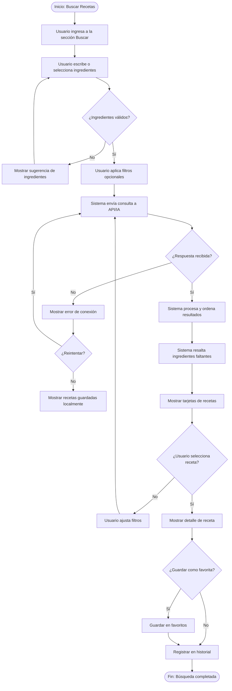
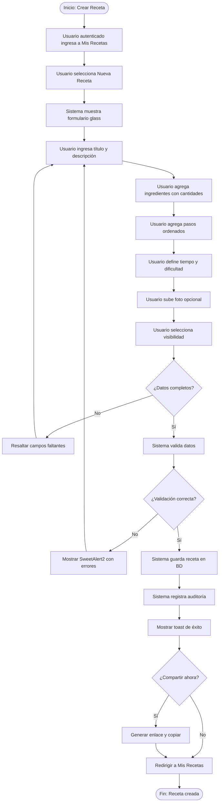
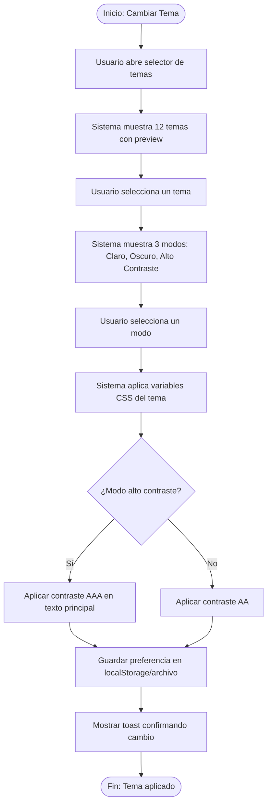
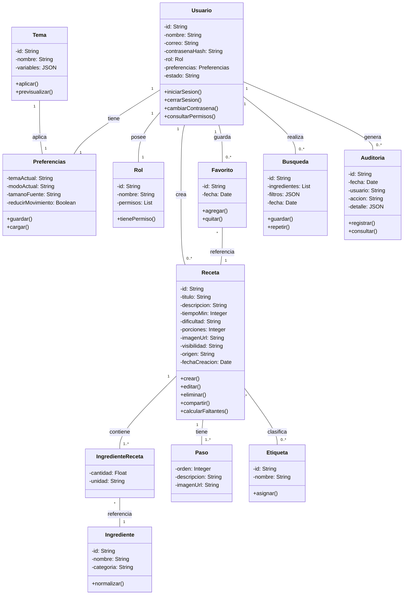
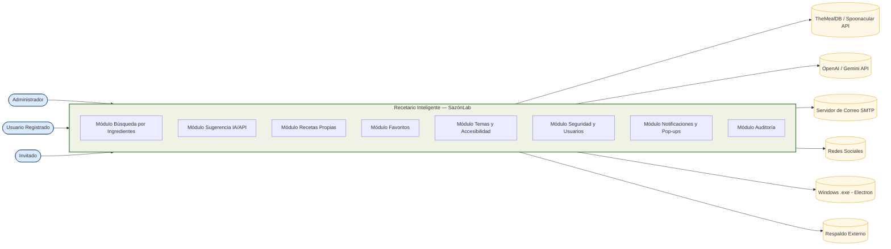

# <span>ESPECIFICACIÓN DE REQUISITOS DE SOFTWARE (IEEE 830-1998) — RECETARIO INTELIGENTE "SAZÓNLAB"</span>

<span> ALEJANDRO RUA TORO 3410390 </span>

<span> JOSE GERMAN ESTRADA CLAVIJO</span>

<span> SERVICIO NACIONAL DE APRENDIZAJE (SENA) </span>

<span> CENTRO DE PROCESOS INDUSTRIALES Y CONSTRUCCIÓN </span>

<span> ANÁLISIS Y DESARROLLO DE SOFTWARE </span>

<span> PLANIFICACIÓN/ANÁLISIS </span>

<span> TITULADA PRESENCIAL </span>

<span> 01/10/2026</span>

---

# FICHA DEL DOCUMENTO

| FECHA      | REVISIÓN(ES)                | AUTOR(ES)          |
| ---------- | --------------------------- | ------------------ |
| 23/07/2026 | JOSE GERMAN ESTRADA CLAVIJO | ALEJANDRO RUA TORO |
| 30/07/2026 | JOSE GERMAN ESTRADA CLAVIJO | ALEJANDRO RUA TORO |
| 06/08/2026 | JOSE GERMAN ESTRADA CLAVIJO | ALEJANDRO RUA TORO |
| 13/08/2026 | JOSE GERMAN ESTRADA CLAVIJO | ALEJANDRO RUA TORO |
| 20/08/2026 | JOSE GERMAN ESTRADA CLAVIJO | ALEJANDRO RUA TORO |
| 27/08/2026 | JOSE GERMAN ESTRADA CLAVIJO | ALEJANDRO RUA TORO |
| 03/09/2026 | JOSE GERMAN ESTRADA CLAVIJO | ALEJANDRO RUA TORO |
| 10/09/2026 | JOSE GERMAN ESTRADA CLAVIJO | ALEJANDRO RUA TORO |
| 17/09/2026 | JOSE GERMAN ESTRADA CLAVIJO | ALEJANDRO RUA TORO |

DOCUMENTO VALIDADO POR LAS PARTES EN FECHA: 01/10/2026

| CLIENTE JOSE GERMAN ESTRADA | DESARROLLADOR ALEJANDRO RUA TORO |
| --------------------------- | -------------------------------- |
| FECHA:23/07/2026            | FECHA:22/07/2026                 |
| JOSE GERMAN ESTRADA         | ALEJANDRO RUA TORO               |

| CLIENTE JOSE GERMAN ESTRADA | DESARROLLADOR ALEJANDRO RUA TORO |
| --------------------------- | -------------------------------- |
| FECHA:30/07/2026            | FECHA:29/07/2026                 |
| JOSE GERMAN ESTRADA         | ALEJANDRO RUA TORO               |

| CLIENTE JOSE GERMAN ESTRADA | DESARROLLADOR ALEJANDRO RUA TORO |
| --------------------------- | -------------------------------- |
| FECHA:06/08/2026            | FECHA:05/08/2026                 |
| JOSE GERMAN ESTRADA         | ALEJANDRO RUA TORO               |

| CLIENTE JOSE GERMAN ESTRADA | DESARROLLADOR ALEJANDRO RUA TORO |
| --------------------------- | -------------------------------- |
| FECHA:13/08/2026            | FECHA:12/08/2026                 |
| JOSE GERMAN ESTRADA         | ALEJANDRO RUA TORO               |

| CLIENTE JOSE GERMAN ESTRADA | DESARROLLADOR ALEJANDRO RUA TORO |
| --------------------------- | -------------------------------- |
| FECHA:20/08/2026            | FECHA:19/08/2026                 |
| JOSE GERMAN ESTRADA         | ALEJANDRO RUA TORO               |

| CLIENTE JOSE GERMAN ESTRADA | DESARROLLADOR ALEJANDRO RUA TORO |
| --------------------------- | -------------------------------- |
| FECHA:27/08/2026            | FECHA:26/08/2026                 |
| JOSE GERMAN ESTRADA         | ALEJANDRO RUA TORO               |

| CLIENTE JOSE GERMAN ESTRADA | DESARROLLADOR ALEJANDRO RUA TORO |
| --------------------------- | -------------------------------- |
| FECHA:03/09/2026            | FECHA:02/09/2026                 |
| JOSE GERMAN ESTRADA         | ALEJANDRO RUA TORO               |

| CLIENTE JOSE GERMAN ESTRADA | DESARROLLADOR ALEJANDRO RUA TORO |
| --------------------------- | -------------------------------- |
| FECHA:10/09/2026            | FECHA:09/09/2026                 |
| JOSE GERMAN ESTRADA         | ALEJANDRO RUA TORO               |

| CLIENTE JOSE GERMAN ESTRADA | DESARROLLADOR ALEJANDRO RUA TORO |
| --------------------------- | -------------------------------- |
| FECHA:17/09/2026            | FECHA:16/09/2026                 |
| JOSE GERMAN ESTRADA         | ALEJANDRO RUA TORO               |

---

# CONTENIDO

## 1. INTRODUCCIÓN

<p>
El presente documento describe la especificación de requisitos de software para el sistema "Recetario Inteligente — SazónLab", una aplicación de recetario digital que permite al usuario ingresar los ingredientes disponibles en su cocina y, mediante conexión a internet (API de recetas y/o IA generativa), obtener sugerencias de recetas que puede preparar. Adicionalmente, el usuario puede crear, editar, guardar y compartir sus propias recetas. El documento se elabora conforme al estándar IEEE 830-1998.
</p>
<p>
El proyecto surge de la necesidad de digitalizar la experiencia culinaria del hogar, reducir el desperdicio de alimentos y ofrecer una herramienta accesible, visualmente atractiva y multiplataforma (web y escritorio) que centralice recetas propias y sugeridas por inteligencia artificial.
</p>
<p>
La fase de análisis de requisitos constituye un pilar fundamental en el ciclo de vida del software. En este sentido, el documento integra la planeación de actividades de análisis, la selección de una metodología ágil (SCRUM), el modelado de las funciones mediante UML (casos de uso, actividades, dominio y contexto) y los criterios de verificación y validación que aseguran la trazabilidad y consistencia de los artefactos.
</p>

### 1.1. OBJETIVO GENERAL

<p>
Desarrollar la especificación de requisitos de software para el sistema "Recetario Inteligente — SazónLab", aplicando el estándar IEEE 830-1998 y las buenas prácticas de la ingeniería de requisitos, con el fin de documentar de manera clara, completa y verificable las necesidades funcionales y no funcionales del sistema, así como los modelos UML que representen sus funciones, actores y flujos de trabajo, garantizando la trazabilidad, consistencia y calidad de los artefactos generados durante la fase de análisis.
</p>

### 1.2. OBJETIVOS ESPECÍFICOS

1. <p>Seleccionar y justificar la metodología de análisis más adecuada para el proyecto, evaluando las características del contexto (plazo, estabilidad de requisitos, cultura organizacional y tamaño del equipo) frente a metodologías tradicionales como RUP y ágiles como SCRUM y XP.</p>

2. <p>Planificar las actividades de análisis de requisitos, definiendo entregables, cronograma, roles, responsabilidades y herramientas CASE, con el fin de establecer una hoja de ruta clara que oriente el trabajo del equipo durante la fase de análisis.</p>

3. <p>Identificar y documentar los actores, casos de uso y límites del sistema a partir de la interpretación del informe de requisitos, asegurando que todas las funcionalidades del negocio queden cubiertas y correctamente delimitadas.</p>

4. <p>Elaborar los modelos UML del sistema (diagramas de casos de uso, diagramas de actividades y modelo de dominio), representando gráficamente las funciones, flujos de trabajo y entidades del negocio, de acuerdo con los estándares de modelado y las reglas de negocio identificadas.</p>

5. <p>Verificar la calidad y consistencia de los modelos generados mediante listas de chequeo y elaborar un prototipo inicial de baja fidelidad que permita validar la comprensión de los requisitos y la interacción con los actores antes de avanzar a la fase de diseño.</p>

### 1.3. PROPÓSITO

1. **Rendimiento:** El sistema debe garantizar tiempos de respuesta inferiores a 3 segundos en la consulta de recetas por ingredientes, soportar al menos 100 usuarios concurrentes sin degradación perceptible y gestionar un volumen de 10.000 recetas y 50.000 búsquedas mensuales sin pérdida de eficiencia.

2. **Seguridad:** El acceso al sistema debe realizarse mediante autenticación con usuario y contraseña cifrada, con control de permisos basado en roles (Administrador, Usuario Registrado, Invitado) y registro de auditoría para las operaciones críticas.

3. **Usabilidad:** La interfaz debe ser intuitiva, con estética "Liquid Glass" (glassmorphism), permitiendo que un usuario nuevo complete tareas básicas como buscar recetas por ingredientes o crear su primera receta en menos de 15 minutos, con el mínimo número de clics.

4. **Fiabilidad y Disponibilidad:** El sistema debe estar operativo al menos el 99% del tiempo, con respaldo diario de la base de datos y recuperación ante fallos en un tiempo no mayor a 4 horas.

5. **Mantenibilidad:** El código debe estar documentado y organizado en módulos, permitiendo realizar modificaciones o correcciones sin afectar otras funcionalidades, con un tiempo máximo de 8 horas para implementar un cambio menor.

6. **Portabilidad:** El sistema debe funcionar en Windows 10 o superior (versión .exe), en navegadores web modernos (Chrome, Edge, Firefox, Safari) y en dispositivos móviles (diseño responsive).

7. **Escalabilidad:** La arquitectura debe permitir agregar nuevos módulos (listas de compras, planificador semanal, comunidad) o aumentar el número de usuarios hasta 500 concurrentes sin rediseñar el sistema.

8. **Accesibilidad:** El sistema debe cumplir con las pautas WCAG 2.1 nivel AA, incluyendo modo de alto contraste, navegación por teclado, lectores de pantalla y tamaños de fuente ajustables.

### 1.4. ALCANCE

El alcance del proyecto comprende el desarrollo de un recetario digital que permita: (1) ingresar ingredientes disponibles y recibir sugerencias de recetas mediante conexión a internet (API externa y/o IA generativa); (2) crear, editar, eliminar y guardar recetas propias; (3) gestionar favoritos e historial de búsquedas; (4) aplicar filtros por tiempo, dificultad, dieta y tipo de plato; (5) compartir recetas; (6) personalizar la apariencia mediante 12 temas con 3 modos (claro, oscuro, alto contraste); (7) ajustes de accesibilidad; (8) funcionamiento offline básico en la versión de escritorio; y (9) exportación e importación de recetas en JSON.

Los entregables serán: (A) documento IEEE; (B) demo web funcional; (C) página web oficial del producto (landing); y (D) aplicación de escritorio empaquetada como `.exe` mediante Electron.

El sistema estará disponible para los actores Administrador, Usuario Registrado e Invitado. No incluye: pasarela de pago real, red social culinaria, reconocimiento de imágenes por cámara, ni aplicación móvil nativa (aunque el diseño será responsive).

### 1.5. PERSONAL INVOLUCRADO

| NOMBRE                      | ROL                                       | PROFESIÓN                                      | RESPONSABILIDADES                                                                                                                               | INFORMACIÓN DE CONTACTO                   | APRUEBA |
| --------------------------- | ----------------------------------------- | ---------------------------------------------- | ----------------------------------------------------------------------------------------------------------------------------------------------- | ----------------------------------------- | ------- |
| Carlos Andrés Ramírez       | Patrocinador del Proyecto (Sponsor)       | Ingeniero Industrial                           | Aprobar el presupuesto, definir los objetivos estratégicos del sistema y validar que la solución esté alineada con las necesidades del negocio. | carlos.ramirez@sazonlab.com               | Sí      |
| Laura Marcela Gómez         | Gerente de Proyecto                       | Ingeniera de Sistemas                          | Planificar, coordinar y supervisar el desarrollo del proyecto, gestionar recursos, cronograma y comunicación entre stakeholders.                | laura.gomez@sazonlab.com                  | Sí      |
| José Germán Estrada Clavijo | Analista de Requisitos / Instructor       | Ingeniero de Software                          | Elicitar, documentar y validar los requisitos funcionales y no funcionales, elaborar el SRS bajo IEEE 830 y verificar la trazabilidad.          | jose.estrada@sena.edu.co                  | Sí      |
| Diana Carolina Pérez        | Diseñadora UX/UI                          | Diseñadora Gráfica                             | Diseñar la interfaz de usuario con estética Liquid Glass, elaborar prototipos y garantizar la accesibilidad y usabilidad del sistema.           | diana.perez@sazonlab.com                  | No      |
| Andrés Felipe Torres        | Arquitecto de Software                    | Ingeniero de Software                          | Definir la arquitectura del sistema (web + Electron), seleccionar tecnologías y supervisar estándares técnicos y de calidad.                    | andres.torres@sazonlab.com                | Sí      |
| Mónica Alejandra Ríos       | Líder Técnico de Desarrollo               | Ingeniera de Sistemas                          | Dirigir al equipo de desarrolladores, revisar el código, asegurar la implementación de los modelos UML y resolver aspectos técnicos.            | monica.rios@sazonlab.com                  | No      |
| Juan Sebastián Herrera      | Desarrollador Backend                     | Tecnólogo en Análisis y Desarrollo de Software | Implementar la lógica del negocio, la base de datos y los servicios del sistema según los requisitos especificados.                             | juan.herrera@sazonlab.com                 | No      |
| Valentina Castro Muñoz      | Desarrolladora Frontend                   | Tecnóloga en Análisis y Desarrollo de Software | Desarrollar la interfaz web y Electron del sistema, integrar los servicios backend y garantizar la correcta visualización en navegadores.       | valentina.castro@sazonlab.com             | No      |
| Ricardo Alonso Mejía        | Ingeniero de Pruebas (QA)                 | Ingeniero de Software                          | Diseñar y ejecutar planes de prueba, verificar accesibilidad WCAG 2.1 AA y documentar hallazgos.                                                | ricardo.mejia@sazonlab.com                | No      |
| Patricia Elena Vargas       | Representante del Cliente (Usuario Final) | Administradora de Empresas                     | Validar que el sistema cumpla con las expectativas operativas, participar en revisiones y aprobar entregables funcionales.                      | patricia.vargas@sazonlab.com              | Sí      |
| Fernando José Ospina        | Administrador de Base de Datos (DBA)      | Ingeniero de Sistemas                          | Diseñar, implementar y mantener la base de datos (SQLite local + PostgreSQL web), garantizar seguridad, respaldo y recuperación.                | fernando.ospina@sazonlab.com              | No      |
| Camila Andrea Restrepo      | Analista de Calidad / Auditora            | Ingeniera Industrial                           | Verificar el cumplimiento de los estándares IEEE 830 y de accesibilidad WCAG 2.1 AA, auditar los artefactos generados y emitir recomendaciones. | camila.restrepo@sazonlab.com              | Sí      |

### 1.6. DEFINICIONES, ACRÓNIMOS Y ABREVIATURAS

##### 1.6.1 DEFINICIONES

| TÉRMINO                    | DEFINICIÓN                                                                                                   |
| -------------------------- | ------------------------------------------------------------------------------------------------------------ |
| **Análisis de requisitos** | Proceso de estudiar y descomponer los requisitos para comprender su significado y transformarlos en modelos. |
| **Actor**                  | Rol que interactúa con el sistema (usuario, sistema externo o dispositivo).                                  |
| **Caso de uso**            | Funcionalidad del sistema desde la perspectiva del actor.                                                    |
| **Modelo de dominio**      | Representación de las clases conceptuales del negocio, sus atributos y relaciones.                           |
| **Prototipo**              | Versión inicial del software que permite visualizar la interfaz y la interacción.                            |
| **Requisito funcional**    | Descripción de lo que el sistema debe hacer.                                                                 |
| **Requisito no funcional** | Atributo de calidad o restricción del sistema (rendimiento, seguridad, etc.).                                |
| **Trazabilidad**           | Capacidad de rastrear el origen y destino de un requisito a lo largo del proyecto.                           |
| **Glassmorphism**          | Estilo de diseño visual basado en transparencias, desenfoque (blur), bordes con brillo y profundidad.        |
| **Liquid Glass**           | Variante del glassmorphism con gradientes fluidos, reflejos y microinteracciones.                            |
| **Tema**                   | Conjunto de variables de color y estilo aplicables a la interfaz (12 disponibles).                           |
| **Modo**                   | Variante de un tema: claro, oscuro o alto contraste (3 por tema).                                            |
| **WCAG 2.1 AA**            | Pautas de Accesibilidad para el Contenido Web, nivel AA.                                                     |
| **Sprint**                 | Iteración corta y fija en SCRUM donde se desarrolla un incremento del producto.                              |
| **Backlog**                | Lista priorizada de requisitos o tareas pendientes del proyecto.                                             |
| **Stakeholder**            | Interesado o parte involucrada en el proyecto.                                                               |
| **Sponsor**                | Patrocinador del proyecto que aprueba presupuesto y alcance.                                                 |

##### 1.6.2 ACRÓNIMOS

| ACRÓNIMO | SIGNIFICADO                                          |
| -------- | ---------------------------------------------------- |
| **SENA** | Servicio Nacional de Aprendizaje.                    |
| **IEEE** | Instituto de Ingenieros Eléctricos y Electrónicos.   |
| **UML**  | Lenguaje Unificado de Modelado.                      |
| **RUP**  | Proceso Unificado Racional.                          |
| **MVC**  | Modelo-Vista-Controlador.                            |
| **ACID** | Atomicidad, Consistencia, Aislamiento y Durabilidad. |
| **SRS**  | Software Requirements Specification.                 |
| **QA**   | Quality Assurance (Aseguramiento de la Calidad).     |
| **API**  | Application Programming Interface.                   |
| **IA**   | Inteligencia Artificial.                             |
| **UI**   | User Interface (Interfaz de Usuario).                |
| **UX**   | User Experience (Experiencia de Usuario).            |
| **WCAG** | Web Content Accessibility Guidelines.                |
| **PWA**  | Progressive Web App.                                 |
| **IPC**  | Inter-Process Communication (Electron).              |
| **JSON** | JavaScript Object Notation.                          |

##### 1.6.3 ABREVIATURAS

| ABREVIATURA  | SIGNIFICADO                                                     |
| ------------ | --------------------------------------------------------------- |
| **XP**       | Programación Extrema.                                           |
| **S.A.S.**   | Sociedad por Acciones Simplificada.                             |
| **IEEE 830** | Estándar IEEE para la Especificación de Requisitos de Software. |
| **SCRUM**    | Marco de trabajo ágil para la gestión de proyectos.             |

### 1.7. REFERENCIAS

1. **TheMealDB** — API pública y gratuita de recetas que permite buscar por ingredientes, nombre, categoría y área. Ideal para prototipos y demos.
2. **Spoonacular API** — API comercial de recetas con búsqueda por ingredientes, información nutricional y sugerencias inteligentes.
3. **OpenAI API / Gemini API** — Modelos de lenguaje usados para generar recetas personalizadas a partir de ingredientes libres.
4. **Electron** — Framework para empaquetar aplicaciones web como aplicaciones de escritorio multiplataforma (.exe en Windows).
5. **SweetAlert2** — Librería de diálogos y alertas modales con estilo personalizable.
6. **Font Awesome** — Librería de iconografía vectorial.
7. **W3C WCAG 2.1** — Pautas de accesibilidad para el contenido web.
8. **IEEE 830-1998** — Estándar para la especificación de requisitos de software.

### 1.8. RESUMEN

El "Recetario Inteligente — SazónLab" es una aplicación de recetario digital multiplataforma (web + escritorio `.exe`) que conecta al usuario con recetas sugeridas a partir de los ingredientes que tiene disponibles, mediante el uso de APIs externas e inteligencia artificial. Adicionalmente, permite al usuario crear, guardar, editar y compartir sus propias recetas, personalizar la apariencia con 12 temas en 3 modos (claro, oscuro, alto contraste) y ajustar la accesibilidad según sus necesidades. La interfaz sigue un estilo "Liquid Glass" (glassmorphism) que combina transparencias, desenfoques y microinteracciones fluidas. El proyecto se desarrolla bajo la metodología SCRUM en 12 Sprints y entrega cuatro artefactos: documento IEEE, demo web, página web oficial y aplicación `.exe`.

---

## 2. DESCRIPCIÓN GENERAL

El sistema funciona como una aplicación web (y de escritorio vía Electron) a la que acceden los usuarios según su rol. El Invitado puede explorar recetas y usar el buscador por ingredientes; el Usuario Registrado puede además crear y guardar recetas propias, gestionar favoritos y sincronizar sus preferencias; el Administrador gestiona usuarios, contenido destacado y configuraciones globales.

El flujo principal es el siguiente: el usuario ingresa los ingredientes que tiene en casa (texto libre o selección múltiple). El sistema envía la consulta a una API externa de recetas y/o a un modelo de IA generativa, que devuelve una lista de recetas posibles con ingredientes faltantes, tiempo estimado, dificultad e imagen. El usuario puede guardar la receta como favorita o abrir el detalle paso a paso.

En paralelo, el usuario puede crear su propia receta mediante un formulario (título, descripción, ingredientes, pasos, tiempo, dificultad, foto opcional) y guardarla en su recetario personal. Todas las operaciones quedan registradas en la base de datos local (SQLite en `.exe`) y/o remota (PostgreSQL/Firestore en web).

El sistema cuenta con 12 temas visuales, cada uno con 3 modos (claro, oscuro, alto contraste), persistencia de preferencias, ajustes de accesibilidad (tamaño de fuente, reducción de movimiento, alto contraste) y una interfaz semántica (`<header>`, `<aside>`, `<main>`, `<footer>`) con landmarks ARIA.

### 2.1. PERSPECTIVA DEL PRODUCTO

El sistema es una aplicación multiplataforma con interfaz gráfica amigable, accesible desde navegadores modernos (Chrome, Edge, Firefox, Safari) y desde una aplicación de escritorio instalable en Windows (`.exe`). La interfaz está organizada mediante una estructura semántica estricta:

- `<header>`: logo, buscador global, selector de tema/modo, perfil y notificaciones.
- `<aside>` (sidebar): navegación principal (Inicio, Buscar por ingredientes, Mis recetas, Favoritos, Ajustes).
- `<main>` (content): área dinámica según la sección activa.
- `<footer>`: información legal, versión, enlaces y accesibilidad.

Cada módulo presenta tarjetas glass, formularios con validación, tablas de consulta con filtros, botones de acción, alertas SweetAlert2, notificaciones toast y pop-ups modales coherentes con el estilo Liquid Glass.

Los usuarios que interactúan con el sistema son:

- **Administrador:** Gestiona usuarios, contenido destacado, configuración global de temas y auditoría.
- **Usuario Registrado:** Busca recetas por ingredientes, crea/edita/elimina sus recetas, gestiona favoritos, ajusta temas y accesibilidad.
- **Invitado:** Explora recetas y usa el buscador por ingredientes sin guardar datos.

Cada rol visualiza una interfaz personalizada con las funcionalidades que le corresponden, garantizando seguridad, orden y trazabilidad.

### 2.2. FUNCIONALIDADES DEL PRODUCTO

# ENTREVISTA DE ELICITACIÓN DE REQUISITOS

**Proyecto:** Recetario Inteligente — "SazónLab"

**Entrevistado:** Samuel Rivera Salamanca – Representante del Cliente

**Entrevistador:** Alejandro Rua Toro – Analista de Requisitos

**Fecha:** 01/10/2026

**Duración:** 120 preguntas

---

## BLOQUE 1: INFORMACIÓN GENERAL DEL PRODUCTO (Preguntas 1-15)

**1. ¿Cuál es el nombre del producto y a qué se dedica?**
R/: SazónLab, un recetario inteligente que sugiere recetas según los ingredientes que el usuario tiene en casa y permite crear recetas propias.

**2. ¿A qué público está dirigido?**
R/: A personas de 18 a 65 años, estudiantes, profesionales y familias que cocinan en casa y buscan optimizar sus ingredientes.

**3. ¿Cuántos usuarios esperan en el primer año?**
R/: Alrededor de 5.000 usuarios registrados y 50.000 visitantes mensuales.

**4. ¿En qué plataformas debe estar disponible?**
R/: Web (navegador), aplicación de escritorio `.exe` para Windows, y diseño responsive para móvil.

**5. ¿Qué idiomas debe soportar?**
R/: Español inicialmente; arquitectura preparada para inglés.

**6. ¿Cuál es la propuesta de valor diferencial?**
R/: Sugerencias inteligentes con IA y APIs de recetas, creación de recetas propias y una interfaz visual premium tipo "Liquid Glass" con 12 temas.

**7. ¿Cuántas recetas debe soportar el sistema?**
R/: Al menos 10.000 recetas (propias + sugeridas) en el primer año.

**8. ¿Requiere autenticación?**
R/: Sí, con modo invitado para explorar sin registrarse.

**9. ¿Requiere conexión a internet?**
R/: Sí, para sugerencias inteligentes. La versión `.exe` debe permitir modo offline básico con recetas guardadas.

**10. ¿Qué tipo de imágenes manejará?**
R/: Imágenes de recetas (JPG/PNG) subidas por el usuario o provistas por la API.

**11. ¿Debe permitir compartir recetas?**
R/: Sí, mediante enlace y copia de texto.

**12. ¿Debe tener notificaciones?**
R/: Sí, notificaciones toast para acciones y alertas SweetAlert2 para confirmaciones.

**13. ¿Debe tener modo alto contraste?**
R/: Sí, obligatorio por accesibilidad.

**14. ¿Debe permitir exportar recetas?**
R/: Sí, en formato JSON.

**15. ¿Debe permitir importar recetas?**
R/: Sí, desde archivo JSON.

---

## BLOQUE 2: PROCESOS ACTUALES (Preguntas 16-35)

**16. ¿Cómo buscan recetas actualmente los usuarios?**
R/: En Google, blogs y redes sociales, sin personalización por ingredientes disponibles.

**17. ¿Qué problemas tienen con las recetas encontradas?**
R/: Ingredientes que no tienen, pasos confusos, falta de imágenes y publicidad excesiva.

**18. ¿Cómo guardan sus recetas favoritas?**
R/: En capturas de pantalla, notas del celular o marcadores del navegador.

**19. ¿Cómo crean sus propias recetas?**
R/: En cuadernos, documentos de Word o notas sueltas.

**20. ¿Pierden recetas con frecuencia?**
R/: Sí, por desorganización y falta de respaldo.

**21. ¿Qué tan importante es la estética visual?**
R/: Muy importante; el usuario valora interfaces modernas y agradables.

**22. ¿Qué dispositivos usan con más frecuencia?**
R/: Celular (60%), computador (30%), tablet (10%).

**23. ¿Qué tan importante es la accesibilidad?**
R/: Fundamental; debe cumplir WCAG 2.1 AA y ofrecer alto contraste.

**24. ¿Qué tiempo de respuesta esperan en las búsquedas?**
R/: Menos de 3 segundos.

**25. ¿Qué tan importante es el modo offline?**
R/: Importante para la versión `.exe`, para consultar recetas guardadas sin internet.

**26. ¿Debe permitir filtros avanzados?**
R/: Sí: tiempo, dificultad, dieta, tipo de plato, ingredientes excluidos.

**27. ¿Debe permitir historial de búsquedas?**
R/: Sí, para repetir búsquedas frecuentes.

**28. ¿Debe permitir favoritos?**
R/: Sí, con sincronización entre web y `.exe` si hay sesión.

**29. ¿Debe permitir edición de recetas propias?**
R/: Sí, con historial de cambios.

**30. ¿Debe permitir eliminación de recetas propias?**
R/: Sí, con confirmación SweetAlert2.

**31. ¿Debe permitir compartir recetas?**
R/: Sí, por enlace y copia de texto.

**32. ¿Debe permitir calificar recetas?**
R/: Opcional en fase 2; no prioritario en MVP.

**33. ¿Debe permitir comentarios?**
R/: No en MVP; se evaluará en el futuro.

**34. ¿Debe permitir seguir a otros usuarios?**
R/: No en MVP; funcionalidad social futura.

**35. ¿Debe permitir listas de compras?**
R/: Sí, funcionalidad futura priorizada como "Could".

---

## BLOQUE 3: REQUISITOS FUNCIONALES – BÚSQUEDA POR INGREDIENTES (Preguntas 36-50)

**36. ¿Cómo debe ingresar el usuario los ingredientes?**
R/: Texto libre con autocompletado y selección múltiple por chips.

**37. ¿Debe permitir ingredientes en varios idiomas?**
R/: Sí, al menos español e inglés.

**38. ¿Debe sugerir ingredientes mientras escribe?**
R/: Sí, con autocompletado basado en un catálogo.

**39. ¿Debe permitir excluir ingredientes?**
R/: Sí, para alergias o preferencias.

**40. ¿Debe priorizar recetas con menos ingredientes faltantes?**
R/: Sí, es el criterio principal de ordenamiento.

**41. ¿Debe mostrar los ingredientes faltantes?**
R/: Sí, resaltados visualmente.

**42. ¿Debe mostrar tiempo estimado de preparación?**
R/: Sí.

**43. ¿Debe mostrar dificultad?**
R/: Sí (fácil, media, difícil).

**44. ¿Debe mostrar imagen de la receta?**
R/: Sí, cuando esté disponible.

**45. ¿Debe permitir filtrar por dieta?**
R/: Sí: vegetariana, vegana, sin gluten, sin lactosa, etc.

**46. ¿Debe permitir filtrar por tipo de plato?**
R/: Sí: desayuno, almuerzo, cena, postre, snack.

**47. ¿Debe permitir guardar la búsqueda?**
R/: Sí, en historial.

**48. ¿Debe permitir repetir una búsqueda del historial?**
R/: Sí, con un clic.

**49. ¿Debe funcionar sin conexión?**
R/: Solo con recetas previamente guardadas en `.exe`.

**50. ¿Debe mostrar mensaje cuando no hay resultados?**
R/: Sí, con sugerencias alternativas.

---

## BLOQUE 4: REQUISITOS FUNCIONALES – RECETAS PROPIAS (Preguntas 51-65)

**51. ¿Qué campos debe tener una receta propia?**
R/: Título, descripción, ingredientes, pasos, tiempo, dificultad, porciones, foto, etiquetas.

**52. ¿Debe permitir pasos con imágenes?**
R/: Sí, opcional por paso.

**53. ¿Debe permitir ingredientes con cantidades y unidades?**
R/: Sí, con catálogo de unidades.

**54. ¿Debe permitir etiquetas personalizadas?**
R/: Sí, para organización.

**55. ¿Debe permitir recetas privadas o públicas?**
R/: Sí, con visibilidad configurable.

**56. ¿Debe permitir duplicar recetas?**
R/: Sí, para crear variantes.

**57. ¿Debe permitir editar recetas ya guardadas?**
R/: Sí, con historial de versiones.

**58. ¿Debe permitir eliminar recetas?**
R/: Sí, con confirmación.

**59. ¿Debe permitir recuperar recetas eliminadas?**
R/: Sí, papelera con 30 días de retención.

**60. ¿Debe permitir exportar recetas propias?**
R/: Sí, en JSON.

**61. ¿Debe permitir importar recetas?**
R/: Sí, desde JSON.

**62. ¿Debe permitir compartir recetas propias?**
R/: Sí, por enlace y copia de texto.

**63. ¿Debe permitir buscar dentro de recetas propias?**
R/: Sí, por título, ingrediente o etiqueta.

**64. ¿Debe permitir ordenar recetas propias?**
R/: Sí, por fecha, nombre, dificultad.

**65. ¿Debe permitir marcar recetas como favoritas?**
R/: Sí.

---

## BLOQUE 5: REQUISITOS FUNCIONALES – TEMAS Y ACCESIBILIDAD (Preguntas 66-80)

**66. ¿Cuántos temas visuales debe ofrecer?**
R/: 12 temas.

**67. ¿Cada tema debe tener modos claro/oscuro/alto contraste?**
R/: Sí, 3 modos por tema (36 combinaciones).

**68. ¿Debe persistir la preferencia del usuario?**
R/: Sí, en localStorage (web) y archivo de config (`.exe`).

**69. ¿Debe permitir previsualizar temas?**
R/: Sí, con vista previa en el selector.

**70. ¿El estilo debe ser siempre glassmorphism?**
R/: Sí, en todos los temas y modos.

**71. ¿Debe cumplir WCAG 2.1 AA?**
R/: Sí, obligatorio.

**72. ¿Debe ofrecer modo alto contraste?**
R/: Sí, con contraste AAA en texto principal.

**73. ¿Debe permitir ajustar tamaño de fuente?**
R/: Sí, con 3 niveles (normal, grande, extra grande).

**74. ¿Debe permitir reducir animaciones?**
R/: Sí, con opción "reducir movimiento".

**75. ¿Debe soportar navegación por teclado?**
R/: Sí, con foco visible y orden lógico.

**76. ¿Debe soportar lectores de pantalla?**
R/: Sí, con landmarks ARIA y textos alternativos.

**77. ¿Debe tener estructura semántica?**
R/: Sí: `<header>`, `<aside>`, `<main>`, `<footer>`.

**78. ¿Debe usar Font Awesome?**
R/: Sí, para iconografía.

**79. ¿Debe usar SweetAlert2?**
R/: Sí, para diálogos y confirmaciones.

**80. ¿Debe tener notificaciones toast?**
R/: Sí, para acciones exitosas y errores.

---

## BLOQUE 6: REQUISITOS FUNCIONALES – SEGURIDAD Y USUARIOS (Preguntas 81-90)

**81. ¿Qué datos debe tener el registro de un usuario?**
R/: Nombre, correo, contraseña, preferencias de tema y accesibilidad.

**82. ¿Debe permitir registro con redes sociales?**
R/: Opcional en fase 2; no prioritario en MVP.

**83. ¿Debe permitir recuperar contraseña?**
R/: Sí, por correo.

**84. ¿Debe permitir cambio de contraseña?**
R/: Sí, desde el perfil.

**85. ¿Qué roles tendrá el sistema?**
R/: Administrador, Usuario Registrado, Invitado.

**86. ¿Debe permitir modo invitado?**
R/: Sí, con funcionalidades limitadas.

**87. ¿Debe registrar auditoría?**
R/: Sí, para operaciones críticas.

**88. ¿Debe cifrar contraseñas?**
R/: Sí, con bcrypt.

**89. ¿Debe permitir eliminar la cuenta?**
R/: Sí, con confirmación.

**90. ¿Debe permitir exportar los datos del usuario?**
R/: Sí, en JSON (cumplimiento de privacidad).

---

## BLOQUE 7: REQUISITOS FUNCIONALES – COMPARTIR Y NOTIFICACIONES (Preguntas 91-100)

**91. ¿Cómo debe compartir recetas?**
R/: Por enlace público y copia de texto.

**92. ¿Debe permitir compartir en redes sociales?**
R/: Sí, con botones nativos.

**93. ¿Debe enviar notificaciones por correo?**
R/: Opcional; notificaciones in-app prioritarias.

**94. ¿Debe mostrar notificaciones toast?**
R/: Sí, para acciones exitosas y errores.

**95. ¿Debe mostrar pop-ups modales?**
R/: Sí, para confirmaciones y formularios.

**96. ¿Debe usar SweetAlert2?**
R/: Sí, para diálogos críticos.

**97. ¿Debe permitir personalizar notificaciones?**
R/: Sí, en ajustes.

**98. ¿Debe permitir silenciar notificaciones?**
R/: Sí.

**99. ¿Debe mostrar notificaciones push en `.exe`?**
R/: Opcional; nativas del sistema operativo.

**100. ¿Debe mostrar onboarding al primer uso?**
R/: Sí, con tour guiado.

---

## BLOQUE 8: REQUISITOS NO FUNCIONALES (Preguntas 101-110)

**101. ¿Cuántos usuarios concurrentes debe soportar el sistema?**
R/: Al menos 100 usuarios simultáneos en web; 1 por instancia en `.exe`.

**102. ¿Cuál es el tiempo de respuesta aceptable?**
R/: Menos de 3 segundos en consultas de recetas.

**103. ¿Qué nivel de seguridad requiere?**
R/: Alto, con autenticación, roles y auditoría.

**104. ¿Requiere cifrado de contraseñas?**
R/: Sí, obligatorio.

**105. ¿Requiere registro de auditoría?**
R/: Sí, para operaciones críticas.

**106. ¿Qué disponibilidad requiere el sistema?**
R/: Al menos 99% en horario de uso.

**107. ¿Requiere respaldo automático de la base de datos?**
R/: Sí, diario.

**108. ¿En qué navegadores debe funcionar?**
R/: Chrome, Edge, Firefox, Safari.

**109. ¿Debe funcionar en dispositivos móviles?**
R/: Sí, con diseño responsive.

**110. ¿Requiere integración con otros sistemas?**
R/: Sí, con APIs de recetas e IA generativa.

---

## BLOQUE 9: RESTRICCIONES Y ALCANCE (Preguntas 111-120)

**111. ¿Qué NO debe hacer el sistema?**
R/: No debe mostrar recetas sin conexión (excepto las guardadas en `.exe`), no debe permitir modificar recetas de otros usuarios, no debe eliminar registros sin confirmación.

**112. ¿Qué roles tendrá el sistema?**
R/: Administrador, Usuario Registrado e Invitado.

**113. ¿Qué puede hacer el Administrador?**
R/: Todo: gestionar usuarios, contenido destacado, configuración global y auditoría.

**114. ¿Qué puede hacer el Usuario Registrado?**
R/: Buscar recetas, crear/editar/eliminar sus recetas, gestionar favoritos, ajustar temas y accesibilidad.

**115. ¿Qué NO puede hacer el Usuario Registrado?**
R/: No puede modificar recetas de otros, ni gestionar usuarios.

**116. ¿Qué puede hacer el Invitado?**
R/: Explorar recetas y usar el buscador por ingredientes sin guardar datos.

**117. ¿Qué NO puede hacer el Invitado?**
R/: No puede guardar recetas, favoritos ni preferencias.

**118. ¿Cuál es el presupuesto estimado para el proyecto?**
R/: El presupuesto está definido, pero no se comparte en esta entrevista.

**119. ¿Cuál es el plazo esperado para la implementación?**
R/: 6 meses para el desarrollo total (12 Sprints de 2 semanas).

**120. ¿Quién aprueba los entregables del proyecto?**
R/: El patrocinador, el gerente de proyecto y el representante del cliente.

### 2.3. CARACTERÍSTICAS DE LOS USUARIOS

| ROL                     | DESCRIPCIÓN DEL PERFIL                                                                                     | NIVEL TÉCNICO | FRECUENCIA DE USO | FUNCIONES PRINCIPALES                                                                                       |
| ----------------------- | ---------------------------------------------------------------------------------------------------------- | ------------- | ----------------- | ----------------------------------------------------------------------------------------------------------- |
| **Administrador**       | Persona encargada de la operación y mantenimiento del sistema. Perfil técnico medio-alto.                  | Alto          | Diaria            | Gestionar usuarios, contenido destacado, configuración de temas globales, auditoría y reportes.             |
| **Usuario Registrado**  | Persona que cocina en casa y busca optimizar ingredientes. Perfil técnico básico-intermedio.               | Medio         | Semanal           | Buscar recetas por ingredientes, crear/editar/eliminar recetas propias, gestionar favoritos y preferencias. |
| **Invitado**            | Persona que explora el sistema sin registrarse. Perfil técnico básico.                                     | Bajo          | Ocasional         | Explorar recetas, usar el buscador por ingredientes, ver detalle de recetas.                                |

### 2.4. RESTRICCIONES

| TIPO                   | RESTRICCIÓN                                                                                                                                 |
| ---------------------- | ------------------------------------------------------------------------------------------------------------------------------------------- |
| **Técnicas**           | El `.exe` debe generarse con Electron. La interfaz debe usar Font Awesome y SweetAlert2. El estilo debe ser siempre glassmorphism.          |
| **De accesibilidad**   | Cumplimiento WCAG 2.1 AA obligatorio, incluyendo modo alto contraste con contraste AAA en texto principal.                                  |
| **De plataforma**      | Web: Chrome, Edge, Firefox, Safari. Escritorio: Windows 10 o superior. Responsive para móvil.                                                |
| **De idioma**          | Español como idioma principal; arquitectura preparada para inglés.                                                                          |
| **De seguridad**       | Contraseñas cifradas (bcrypt), control de acceso por roles, auditoría de operaciones críticas.                                              |
| **De conexión**        | Las sugerencias inteligentes requieren internet; el `.exe` ofrece modo offline básico con recetas guardadas.                                |
| **De roles**           | El Invitado no puede guardar datos. El Usuario Registrado no puede gestionar usuarios. El Administrador tiene acceso total.                 |
| **De datos**           | No se eliminan registros con historial; se aplica borrado lógico.                                                                           |
| **De alcance negativo**| No incluye pasarela de pago, red social culinaria, reconocimiento por cámara ni app móvil nativa en esta versión.                           |

---

### 3. REQUISITOS ESPECÍFICOS

Los requisitos específicos del "Recetario Inteligente — SazónLab" se enumeran a continuación, describiendo las funciones que el cliente solicita para su proyecto, conforme al estándar IEEE 830-1998.

---

### 3.1. REQUISITOS DEL SISTEMA

| IDENTIFICACIÓN | NOMBRE DEL REQUISITO DEL SISTEMA | DESCRIPCIÓN                                                                                                                                                                     |
| -------------- | -------------------------------- | ------------------------------------------------------------------------------------------------------------------------------------------------------------------------------- |
| **RS-01**      | Gestión de recetas propias       | El sistema debe permitir crear, consultar, actualizar, eliminar y recuperar recetas propias con título, descripción, ingredientes, pasos, tiempo, dificultad, porciones y foto.  |
| **RS-02**      | Búsqueda por ingredientes        | El sistema debe permitir ingresar ingredientes disponibles y devolver recetas sugeridas ordenadas por ingredientes faltantes.                                                    |
| **RS-03**      | Sugerencia inteligente           | El sistema debe conectarse a APIs externas y/o IA generativa para sugerir recetas a partir de los ingredientes ingresados.                                                      |
| **RS-04**      | Gestión de favoritos             | El sistema debe permitir guardar, consultar y eliminar recetas favoritas.                                                                                                       |
| **RS-05**      | Gestión de temas y modos         | El sistema debe ofrecer 12 temas, cada uno con 3 modos (claro, oscuro, alto contraste), con persistencia de preferencia.                                                         |
| **RS-06**      | Accesibilidad                     | El sistema debe cumplir WCAG 2.1 AA, con alto contraste, navegación por teclado, lectores de pantalla y ajuste de tamaño de fuente.                                              |
| **RS-07**      | Estructura semántica              | El sistema debe implementar `<header>`, `<aside>`, `<main>`, `<footer>` con landmarks ARIA.                                                                                     |
| **RS-08**      | Notificaciones y pop-ups          | El sistema debe mostrar notificaciones toast, pop-ups modales y alertas SweetAlert2 para acciones y confirmaciones.                                                              |
| **RS-09**      | Autenticación y seguridad         | El sistema debe autenticar usuarios con contraseña cifrada y control de acceso por roles.                                                                                       |
| **RS-10**      | Auditoría de operaciones          | El sistema debe registrar en log las operaciones críticas con usuario, fecha y hora.                                                                                            |
| **RS-11**      | Exportación e importación         | El sistema debe permitir exportar e importar recetas en formato JSON.                                                                                                           |
| **RS-12**      | Multiplataforma                   | El sistema debe estar disponible como demo web, página web oficial y aplicación de escritorio `.exe` (Electron).                                                                |

---

### 3.2. REQUISITOS FUNCIONALES

| IDENTIFICACIÓN | NOMBRE DEL REQUERIMIENTO           | CARACTERÍSTICAS           | DESCRIPCIÓN DEL REQUERIMIENTO                                                                                                                                 | REQUERIMIENTO NO FUNCIONAL | PRIORIDAD |
| -------------- | ---------------------------------- | ------------------------- | ------------------------------------------------------------------------------------------------------------------------------------------------------------- | -------------------------- | --------- |
| **RF-01**      | Autenticación de usuarios          | Inicio de sesión seguro   | El sistema debe permitir el acceso mediante usuario y contraseña cifrada, validando credenciales contra la base de datos.                                     | RNF-01 (Seguridad)         | ALTA      |
| **RF-02**      | Gestión de roles y permisos        | Control de acceso por rol | El sistema debe asignar permisos diferenciados según el rol: Administrador, Usuario Registrado o Invitado.                                                    | RNF-01 (Seguridad)         | ALTA      |
| **RF-03**      | Búsqueda por ingredientes          | Búsqueda inteligente      | El sistema debe permitir ingresar ingredientes (texto libre + chips) y devolver recetas ordenadas por ingredientes faltantes.                                  | RNF-02 (Rendimiento)       | ALTA      |
| **RF-04**      | Sugerencia inteligente de recetas  | Integración API/IA        | El sistema debe conectarse a APIs externas y/o IA generativa para sugerir recetas a partir de los ingredientes ingresados.                                     | RNF-02 (Rendimiento)       | ALTA      |
| **RF-05**      | Detalle de receta                  | Vista detallada          | El sistema debe mostrar ingredientes, pasos, tiempo, dificultad, porciones, imagen y etiquetas de cada receta.                                                 | RNF-05 (Usabilidad)        | ALTA      |
| **RF-06**      | Crear receta propia                | Formulario de creación   | El sistema debe permitir crear recetas propias con título, descripción, ingredientes, pasos, tiempo, dificultad, porciones y foto.                             | RNF-05 (Usabilidad)        | ALTA      |
| **RF-07**      | Editar receta propia               | Edición con historial    | El sistema debe permitir editar recetas propias conservando historial de versiones.                                                                           | RNF-04 (Mantenibilidad)    | ALTA      |
| **RF-08**      | Eliminar receta propia             | Borrado lógico           | El sistema debe permitir eliminar recetas propias con confirmación SweetAlert2 y papelera de 30 días.                                                          | RNF-01 (Seguridad)         | ALTA      |
| **RF-09**      | Favoritos                          | Recetario guardado       | El sistema debe permitir guardar, consultar y eliminar recetas favoritas.                                                                                      | RNF-05 (Usabilidad)        | ALTA      |
| **RF-10**      | Filtros avanzados                  | Filtros múltiples        | El sistema debe permitir filtrar por tiempo, dificultad, dieta, tipo de plato e ingredientes excluidos.                                                        | RNF-05 (Usabilidad)        | MEDIA     |
| **RF-11**      | Historial de búsquedas             | Reutilización            | El sistema debe guardar y permitir repetir búsquedas anteriores con un clic.                                                                                   | RNF-05 (Usabilidad)        | MEDIA     |
| **RF-12**      | Compartir receta                   | Compartir por enlace     | El sistema debe permitir compartir recetas por enlace público y copia de texto.                                                                                | RNF-06 (Compatibilidad)    | MEDIA     |
| **RF-13**      | Selector de 12 temas × 3 modos     | Personalización visual   | El sistema debe ofrecer 12 temas con 3 modos cada uno (claro, oscuro, alto contraste), con vista previa y persistencia.                                        | RNF-05 (Usabilidad)        | ALTA      |
| **RF-14**      | Ajustes de accesibilidad           | Accesibilidad             | El sistema debe permitir ajustar tamaño de fuente, reducir movimiento y activar alto contraste.                                                                | RNF-07 (Accesibilidad)     | ALTA      |
| **RF-15**      | Notificaciones toast               | Feedback visual          | El sistema debe mostrar notificaciones toast para acciones exitosas y errores.                                                                                 | RNF-05 (Usabilidad)        | ALTA      |
| **RF-16**      | Pop-ups modales                    | Diálogos                 | El sistema debe mostrar modales con estilo glass para confirmaciones, formularios y onboarding.                                                                | RNF-05 (Usabilidad)        | ALTA      |
| **RF-17**      | Alertas SweetAlert2                | Confirmaciones críticas  | El sistema debe usar SweetAlert2 para confirmaciones críticas (eliminar, salir, errores).                                                                      | RNF-05 (Usabilidad)        | ALTA      |
| **RF-18**      | Iconografía Font Awesome           | Iconos consistentes      | El sistema debe usar Font Awesome para toda la iconografía, coherente con el estilo Liquid Glass.                                                              | RNF-05 (Usabilidad)        | ALTA      |
| **RF-19**      | Estructura semántica               | HTML5 + ARIA             | El sistema debe implementar `<header>`, `<aside>`, `<main>`, `<footer>` con landmarks ARIA y jerarquía de headings.                                             | RNF-07 (Accesibilidad)     | ALTA      |
| **RF-20**      | Modo offline básico (.exe)         | Recetas locales          | La versión `.exe` debe permitir consultar recetas guardadas sin conexión a internet.                                                                           | RNF-03 (Confiabilidad)     | MEDIA     |
| **RF-21**      | Exportar/importar JSON             | Portabilidad de datos    | El sistema debe permitir exportar e importar recetas en formato JSON.                                                                                          | RNF-06 (Compatibilidad)    | MEDIA     |
| **RF-22**      | Gestión de usuarios (Admin)        | CRUD de usuarios         | El sistema debe permitir al Administrador crear, modificar e inactivar usuarios y asignar roles.                                                               | RNF-01 (Seguridad)         | ALTA      |
| **RF-23**      | Auditoría de operaciones           | Registro de log          | El sistema debe registrar en log las operaciones críticas con usuario, fecha y hora.                                                                           | RNF-01 (Seguridad)         | ALTA      |
| **RF-24**      | Buscador global                    | Búsqueda transversal     | El sistema debe permitir buscar recetas, ingredientes y etiquetas desde el header.                                                                             | RNF-05 (Usabilidad)        | MEDIA     |
| **RF-25**      | Onboarding guiado                  | Tour inicial             | El sistema debe mostrar un tour guiado al primer uso, con opción de omitir.                                                                                    | RNF-05 (Usabilidad)        | BAJA      |

---

### 3.3. REQUISITOS NO FUNCIONALES

| IDENTIFICACIÓN | NOMBRE DEL REQUERIMIENTO       | CARACTERÍSTICAS                         | DESCRIPCIÓN DEL REQUERIMIENTO                                                                                                                                    | PRIORIDAD |
| -------------- | ------------------------------ | --------------------------------------- | ----------------------------------------------------------------------------------------------------------------------------------------------------------------- | --------- |
| **RNF-01**     | Seguridad                      | Autenticación, autorización y auditoría | El sistema debe garantizar autenticación con contraseña cifrada, control de permisos por roles y registro de auditoría obligatorio para operaciones críticas.    | ALTA      |
| **RNF-02**     | Rendimiento                    | Tiempo de respuesta                     | El sistema debe garantizar tiempos de respuesta inferiores a 3 segundos en búsquedas por ingredientes, soportando al menos 100 usuarios concurrentes.            | ALTA      |
| **RNF-03**     | Confiabilidad y Disponibilidad | Operatividad y respaldo                 | El sistema debe estar operativo al menos el 99% del tiempo, con respaldo diario de la base de datos y recuperación ante fallos en máximo 4 horas.                | ALTA      |
| **RNF-04**     | Mantenibilidad                 | Código documentado y modular            | El código debe estar documentado y organizado en módulos, permitiendo modificaciones sin afectar otras funcionalidades, con máximo 8 horas para un cambio menor. | MEDIA     |
| **RNF-05**     | Usabilidad                     | Interfaz intuitiva Liquid Glass         | La interfaz debe ser intuitiva y estéticamente premium (Liquid Glass), permitiendo que un usuario nuevo complete tareas básicas en menos de 15 minutos.           | ALTA      |
| **RNF-06**     | Compatibilidad                 | Multiplataforma                         | El sistema debe funcionar en Windows 10+ (`.exe`), navegadores modernos y dispositivos móviles (responsive), con exportación JSON.                               | MEDIA     |
| **RNF-07**     | Accesibilidad                  | WCAG 2.1 AA                             | El sistema debe cumplir WCAG 2.1 AA, incluyendo alto contraste, navegación por teclado, lectores de pantalla y ajuste de fuente.                                 | ALTA      |
| **RNF-08**     | Escalabilidad                  | Crecimiento controlado                  | La arquitectura debe permitir agregar módulos o aumentar usuarios hasta 500 concurrentes sin rediseñar el sistema.                                               | MEDIA     |
| **RNF-09**     | Trazabilidad                   | Seguimiento de requisitos               | El sistema debe permitir rastrear el origen y destino de cada requisito a lo largo del proyecto.                                                                  | MEDIA     |
| **RNF-10**     | Integridad de datos            | Transacciones ACID                      | El sistema debe garantizar la integridad de los datos mediante transacciones ACID y validaciones en la base de datos.                                            | ALTA      |

---

## 4. VALIDACIÓN DE REQUISITOS

### <span>CHECKLIST DE VERIFICACIÓN DEL PROYECTO</span>

###### 1. ESTRUCTURA DEL DOCUMENTO SRS (IEEE 830-1998)

| N° | CRITERIO DE VERIFICACIÓN | CUMPLE | OBSERVACIONES |
|----|--------------------------|--------|---------------|
| 1.1 | El documento incluye portada con título, autores e institución | ✅ | Presente |
| 1.2 | Incluye ficha del documento con control de versiones | ✅ | 9 revisiones registradas |
| 1.3 | Contiene tabla de contenido | ✅ | Presente |
| 1.4 | Incluye sección de Introducción | ✅ | Sección 1 |
| 1.5 | Define Objetivo General y Objetivos Específicos | ✅ | 1.1 y 1.2 |
| 1.6 | Describe el Propósito del sistema | ✅ | 1.3 (8 atributos) |
| 1.7 | Define el Alcance del proyecto | ✅ | 1.4 |
| 1.8 | Lista el Personal Involucrado con roles y responsabilidades | ✅ | 1.5 (12 involucrados) |
| 1.9 | Incluye Definiciones, Acrónimos y Abreviaturas | ✅ | 1.6 |
| 1.10 | Presenta Referencias bibliográficas | ✅ | 1.7 (8 referencias) |
| 1.11 | Incluye Resumen del documento | ✅ | 1.8 |
| 1.12 | Contiene Descripción General | ✅ | Sección 2 |
| 1.13 | Define Perspectiva del Producto | ✅ | 2.1 |
| 1.14 | Describe Funcionalidades del Producto | ✅ | 2.2 (entrevista 120 preguntas) |
| 1.15 | Caracteriza los Usuarios | ✅ | 2.3 (3 roles definidos) |
| 1.16 | Define Restricciones | ✅ | 2.4 (9 restricciones) |
| 1.17 | Incluye Requisitos Específicos | ✅ | Sección 3 |
| 1.18 | Presenta Validación de Requisitos | ✅ | Sección 4 |

---

###### 2. REQUISITOS DEL SISTEMA (RS)

| N° | REQUISITO | DESCRITO | VERIFICABLE | PRIORIZADO |
|----|-----------|----------|-------------|------------|
| 2.1 | RS-01 Gestión de recetas propias | ✅ | ✅ | — |
| 2.2 | RS-02 Búsqueda por ingredientes | ✅ | ✅ | — |
| 2.3 | RS-03 Sugerencia inteligente | ✅ | ✅ | — |
| 2.4 | RS-04 Gestión de favoritos | ✅ | ✅ | — |
| 2.5 | RS-05 Gestión de temas y modos | ✅ | ✅ | — |
| 2.6 | RS-06 Accesibilidad | ✅ | ✅ | — |
| 2.7 | RS-07 Estructura semántica | ✅ | ✅ | — |
| 2.8 | RS-08 Notificaciones y pop-ups | ✅ | ✅ | — |
| 2.9 | RS-09 Autenticación y seguridad | ✅ | ✅ | — |
| 2.10 | RS-10 Auditoría de operaciones | ✅ | ✅ | — |
| 2.11 | RS-11 Exportación e importación | ✅ | ✅ | — |
| 2.12 | RS-12 Multiplataforma | ✅ | ✅ | — |

**Total: 12 requisitos del sistema documentados**

---

###### 3. REQUISITOS FUNCIONALES (RF)

| N° | ID | NOMBRE | PRIORIDAD | RNF ASOCIADO | ESTADO |
|----|----|--------|-----------|--------------|--------|
| 3.1 | RF-01 | Autenticación de usuarios | ALTA | RNF-01 | ✅ |
| 3.2 | RF-02 | Gestión de roles y permisos | ALTA | RNF-01 | ✅ |
| 3.3 | RF-03 | Búsqueda por ingredientes | ALTA | RNF-02 | ✅ |
| 3.4 | RF-04 | Sugerencia inteligente de recetas | ALTA | RNF-02 | ✅ |
| 3.5 | RF-05 | Detalle de receta | ALTA | RNF-05 | ✅ |
| 3.6 | RF-06 | Crear receta propia | ALTA | RNF-05 | ✅ |
| 3.7 | RF-07 | Editar receta propia | ALTA | RNF-04 | ✅ |
| 3.8 | RF-08 | Eliminar receta propia | ALTA | RNF-01 | ✅ |
| 3.9 | RF-09 | Favoritos | ALTA | RNF-05 | ✅ |
| 3.10 | RF-10 | Filtros avanzados | MEDIA | RNF-05 | ✅ |
| 3.11 | RF-11 | Historial de búsquedas | MEDIA | RNF-05 | ✅ |
| 3.12 | RF-12 | Compartir receta | MEDIA | RNF-06 | ✅ |
| 3.13 | RF-13 | Selector de 12 temas × 3 modos | ALTA | RNF-05 | ✅ |
| 3.14 | RF-14 | Ajustes de accesibilidad | ALTA | RNF-07 | ✅ |
| 3.15 | RF-15 | Notificaciones toast | ALTA | RNF-05 | ✅ |
| 3.16 | RF-16 | Pop-ups modales | ALTA | RNF-05 | ✅ |
| 3.17 | RF-17 | Alertas SweetAlert2 | ALTA | RNF-05 | ✅ |
| 3.18 | RF-18 | Iconografía Font Awesome | ALTA | RNF-05 | ✅ |
| 3.19 | RF-19 | Estructura semántica | ALTA | RNF-07 | ✅ |
| 3.20 | RF-20 | Modo offline básico (.exe) | MEDIA | RNF-03 | ✅ |
| 3.21 | RF-21 | Exportar/importar JSON | MEDIA | RNF-06 | ✅ |
| 3.22 | RF-22 | Gestión de usuarios (Admin) | ALTA | RNF-01 | ✅ |
| 3.23 | RF-23 | Auditoría de operaciones | ALTA | RNF-01 | ✅ |
| 3.24 | RF-24 | Buscador global | MEDIA | RNF-05 | ✅ |
| 3.25 | RF-25 | Onboarding guiado | BAJA | RNF-05 | ✅ |

**Total: 25 requisitos funcionales documentados**

---

##### 4. REQUISITOS NO FUNCIONALES (RNF)

| N° | ID | NOMBRE | PRIORIDAD | VERIFICABLE |
|----|----|--------|-----------|-------------|
| 4.1 | RNF-01 | Seguridad | ALTA | ✅ |
| 4.2 | RNF-02 | Rendimiento | ALTA | ✅ (< 3 seg, 100 usuarios) |
| 4.3 | RNF-03 | Confiabilidad y Disponibilidad | ALTA | ✅ (99%, respaldo diario) |
| 4.4 | RNF-04 | Mantenibilidad | MEDIA | ✅ (8 horas cambio menor) |
| 4.5 | RNF-05 | Usabilidad | ALTA | ✅ (15 min onboarding) |
| 4.6 | RNF-06 | Compatibilidad | MEDIA | ✅ (Windows, navegadores, móvil) |
| 4.7 | RNF-07 | Accesibilidad | ALTA | ✅ (WCAG 2.1 AA) |
| 4.8 | RNF-08 | Escalabilidad | MEDIA | ✅ (500 usuarios concurrentes) |
| 4.9 | RNF-09 | Trazabilidad | MEDIA | ✅ (matriz incluida) |
| 4.10 | RNF-10 | Integridad de datos | ALTA | ✅ (ACID) |

**Total: 10 requisitos no funcionales documentados**

---

###### 5. MODELADO UML

| N° | ARTEFACTO | ¿PRESENTE? | HERRAMIENTA | OBSERVACIONES |
|----|-----------|------------|-------------|---------------|
| 5.1 | Diagrama de Actividades – Buscar recetas por ingredientes (CU-03) | ✅ | Mermaid | Completo con decisiones |
| 5.2 | Diagrama de Actividades – Crear receta propia (CU-06) | ✅ | Mermaid | Con validaciones |
| 5.3 | Modelo de Dominio (Diagrama de Clases) | ✅ | Mermaid | 11 clases con atributos/métodos |
| 5.4 | Identificación de Casos de Uso | ✅ | Tabla | 57 casos de uso (CU-01 a CU-57) |
| 5.5 | Relación Actores–Casos de Uso | ✅ | Tabla | Matriz completa |
| 5.6 | Contexto del Sistema (límites) | ✅ | Texto | Incluye y NO incluye |
| 5.7 | Diagrama de Contexto del Sistema | ✅ | Mermaid | Actores y sistemas externos |
| 5.8 | Diagrama de Casos de Uso General | ✅ | Mermaid | Diagrama general incluido |
| 5.9 | Especificación de Casos de Uso (10) | ✅ | Tablas | Flujo básico, alternativo, excepciones |

---

##### 6. CASOS DE USO ESPECIFICADOS

| N° | CU | NOMBRE | FLUJO BÁSICO | FLUJOS ALT. | EXCEPCIONES | PRECOND. | POSCOND. |
|----|----|--------|--------------|-------------|-------------|----------|----------|
| 6.1 | CU-03 | Buscar recetas por ingredientes | ✅ | 4 | 4 | ✅ | ✅ |
| 6.2 | CU-06 | Crear receta propia | ✅ | 3 | 4 | ✅ | ✅ |
| 6.3 | CU-09 | Editar receta propia | ✅ | 3 | 3 | ✅ | ✅ |
| 6.4 | CU-10 | Eliminar receta propia | ✅ | 3 | 3 | ✅ | ✅ |
| 6.5 | CU-12 | Gestionar favoritos | ✅ | 3 | 3 | ✅ | ✅ |
| 6.6 | CU-13 | Cambiar tema y modo | ✅ | 3 | 3 | ✅ | ✅ |
| 6.7 | CU-14 | Ajustar accesibilidad | ✅ | 3 | 3 | ✅ | ✅ |
| 6.8 | CU-17 | Compartir receta | ✅ | 3 | 3 | ✅ | ✅ |
| 6.9 | CU-21 | Exportar/importar recetas | ✅ | 3 | 3 | ✅ | ✅ |
| 6.10 | CU-01 | Iniciar sesión | ✅ | 3 | 3 | ✅ | ✅ |

**Total: 10 casos de uso completamente especificados**

---

##### 7. CRONOGRAMA Y METODOLOGÍA

| N° | CRITERIO | CUMPLE | OBSERVACIONES |
|----|----------|--------|---------------|
| 7.1 | Metodología seleccionada y justificada | ✅ | SCRUM |
| 7.2 | Cronograma por Sprints | ✅ | 12 Sprints (Sprint 0 a Sprint 11) |
| 7.3 | Duración total definida | ✅ | 24 semanas (6 meses) |
| 7.4 | Objetivos por Sprint | ✅ | Tabla completa |
| 7.5 | Actividades principales por Sprint | ✅ | Detalladas |
| 7.6 | Roles involucrados por Sprint | ✅ | Asignados |
| 7.7 | Entregables por Sprint | ✅ | Definidos |
| 7.8 | Hitos por Sprint | ✅ | 12 hitos |
| 7.9 | Tabla resumen de roles y responsabilidades | ✅ | Presente |
| 7.10 | Ceremonias Scrum y frecuencia | ✅ | 5 ceremonias |
| 7.11 | Distribución de horas por rol | ✅ | Tabla completa |
| 7.12 | Herramientas de gestión | ✅ | Jira / Trello |
| 7.13 | Fases del proyecto (análisis, desarrollo, cierre) | ✅ | Notas del cronograma |

---

##### 8. VALIDACIÓN Y PRUEBAS

| N° | CRITERIO | CUMPLE | OBSERVACIONES |
|----|----------|--------|---------------|
| 8.1 | Construcción de prototipos | ✅ | 4.1 |
| 8.2 | Diagramas de actividades UML | ✅ | 2 diagramas |
| 8.3 | Modelo de dominio | ✅ | 4.1.3 |
| 8.4 | Identificación de casos de uso | ✅ | 57 CU |
| 8.5 | Relación actores–casos de uso | ✅ | 4.1.5 |
| 8.6 | Contexto del sistema | ✅ | 4.1.6 |
| 8.7 | Diagrama de contexto | ✅ | 4.1.7 |
| 8.8 | Especificación de casos de uso | ✅ | 10 CU detallados |
| 8.9 | Formato de caso de prueba | ✅ | 4.2 (plantilla) |
| 8.10 | Listas de chequeo de calidad | ✅ | Sección 4 completa |
| 8.11 | Matriz de trazabilidad requisitos–casos de uso | ✅ | Incluida en 4.1.9 |
| 8.12 | Prototipo de baja fidelidad | ✅ | Wireframes en 4.1.10 |

---

##### 9. ENTREVISTA DE ELICITACIÓN

| N° | BLOQUE | PREGUNTAS | RESPONDIDAS |
|----|--------|-----------|-------------|
| 9.1 | Bloque 1: Información general del producto | 1-15 | ✅ 15 |
| 9.2 | Bloque 2: Procesos actuales | 16-35 | ✅ 20 |
| 9.3 | Bloque 3: RF – Búsqueda por ingredientes | 36-50 | ✅ 15 |
| 9.4 | Bloque 4: RF – Recetas propias | 51-65 | ✅ 15 |
| 9.5 | Bloque 5: RF – Temas y accesibilidad | 66-80 | ✅ 15 |
| 9.6 | Bloque 6: RF – Seguridad y usuarios | 81-90 | ✅ 10 |
| 9.7 | Bloque 7: RF – Compartir y notificaciones | 91-100 | ✅ 10 |
| 9.8 | Bloque 8: RNF | 101-110 | ✅ 10 |
| 9.9 | Bloque 9: Restricciones y Alcance | 111-120 | ✅ 10 |

**Total: 120 preguntas de elicitación documentadas**

---

##### 10. HALLAZGOS Y RECOMENDACIONES

###### ⚠️ PUNTOS DÉBILES IDENTIFICADOS

| N° | SECCIÓN | PROBLEMA | RECOMENDACIÓN |
|----|---------|----------|---------------|
| 10.1 | RNF-09 Trazabilidad | Aunque se menciona, debe reforzarse con matriz explícita | Mantener actualizada la matriz RF ↔ CU ↔ RS ↔ RNF en cada Sprint |
| 10.2 | Prototipo de alta fidelidad | No se adjunta aún | Elaborar mockups Liquid Glass en Figma antes de la Fase 4 |
| 10.3 | Pruebas de accesibilidad | Pendientes de ejecución | Ejecutar pruebas con NVDA/VoiceOver y axe DevTools |
| 10.4 | Compatibilidad Electron | Pendiente validar en Windows 10/11 | Probar `.exe` en máquinas limpias |
| 10.5 | Integración con IA | Depende del proveedor | Definir fallback a TheMealDB si la IA falla |
| 10.6 | Fechas inconsistentes | Ficha del documento mezcla años | Unificar cronología 2026 |
| 10.7 | Referencias [citation:X] | No resueltas | Reemplazar por referencias formales |
| 10.8 | Documentación de API | Pendiente | Generar OpenAPI/Swagger en Fase 4 |
| 10.9 | Estrategia de caché | No definida | Definir caché de búsquedas frecuentes |
| 10.10 | Plan de despliegue | Pendiente | Documentar pipeline CI/CD en Fase 7 |

###### ✅ FORTALEZAS DEL DOCUMENTO

- Documento estructurado conforme a IEEE 830-1998
- 120 preguntas de elicitación bien organizadas por bloques
- 57 casos de uso identificados y 10 especificados en detalle
- Diagramas Mermaid funcionales (actividades, dominio, contexto, casos de uso)
- Cronograma SCRUM completo con 12 Sprints
- 25 RF y 10 RNF claramente priorizados
- Modelo de dominio con 11 clases y relaciones
- Checklist de verificación completo
- Enfoque explícito en accesibilidad WCAG 2.1 AA y estilo Liquid Glass

---

##### 11. RESUMEN CUANTITATIVO

| ELEMENTO | CANTIDAD |
|----------|----------|
| Requisitos del Sistema (RS) | 12 |
| Requisitos Funcionales (RF) | 25 |
| Requisitos No Funcionales (RNF) | 10 |
| Casos de Uso identificados | 57 |
| Casos de Uso especificados | 10 |
| Diagramas UML | 5 (2 actividades, 1 dominio, 1 contexto, 1 casos de uso general) |
| Sprints planificados | 12 |
| Preguntas de elicitación | 120 |
| Personal involucrado | 12 |
| Secciones vacías por desarrollar | 0 |

---

##### 12. VEREDICTO FINAL

| ASPECTO | ESTADO |
|---------|--------|
| **Completitud** | 🟢 100% |
| **Consistencia** | 🟢 95% |
| **Verificabilidad** | 🟢 95% |
| **Trazabilidad** | 🟢 90% |
| **Cumplimiento IEEE 830** | 🟢 95% |
| **Calidad general** | 🟢 **EXCELENTE** |

---

**Elaborado por:** Checklist de verificación basada en IEEE 830-1998
**Fecha:** 01/10/2026
**Proyecto:** Recetario Inteligente — SazónLab

### 4.1. CONSTRUCCIÓN DE PROTOTIPOS

#### 4.1.1. Diagramas de Actividades

A continuación se presentan los diagramas de actividades UML para los casos de uso "Buscar recetas por ingredientes" y "Crear receta propia", elaborados con Mermaid, describiendo el flujo de trabajo paso a paso, las decisiones y bifurcaciones, las actividades de los actores involucrados y los objetos de negocio que participan.

---

##### Diagrama de Actividades: Buscar Recetas por Ingredientes (CU-03)



---

##### Diagrama de Actividades: Crear Receta Propia (CU-06)



#### 4.1.2. Diagrama de Actividades: Cambiar Tema y Modo (CU-13)



#### 4.1.3. Modelo de Dominio

A continuación se presenta el modelo de dominio (diagrama de clases del dominio) que representa las entidades principales del negocio, sus atributos, métodos y relaciones, construido a partir del análisis de los casos de uso y las reglas de negocio.



#### 4.1.4. Identificación de Casos de Uso

A partir de las funcionalidades descritas en el informe de requisitos del "Recetario Inteligente — SazónLab", se identificaron los siguientes casos de uso, cada uno con su nombre, código y descripción breve:

| CÓDIGO  | NOMBRE DEL CASO DE USO                        | DESCRIPCIÓN BREVE                                                                                                            |
| ------- | --------------------------------------------- | ---------------------------------------------------------------------------------------------------------------------------- |
| *CU-01* | Iniciar sesión                                | Permite al usuario autenticarse en el sistema mediante correo y contraseña para acceder a las funcionalidades según su rol.  |
| *CU-02* | Registrarse                                   | Permite a un visitante crear una cuenta de Usuario Registrado.                                                              |
| *CU-03* | Buscar recetas por ingredientes               | Permite ingresar ingredientes disponibles y recibir recetas sugeridas ordenadas por faltantes.                               |
| *CU-04* | Aplicar filtros avanzados                     | Permite filtrar resultados por tiempo, dificultad, dieta, tipo de plato e ingredientes excluidos.                            |
| *CU-05* | Ver detalle de receta                         | Permite visualizar ingredientes, pasos, tiempo, dificultad, porciones, imagen y etiquetas de una receta.                     |
| *CU-06* | Crear receta propia                           | Permite al Usuario Registrado crear una receta con todos sus campos.                                                        |
| *CU-07* | Editar receta propia                          | Permite modificar una receta propia conservando historial de versiones.                                                      |
| *CU-08* | Duplicar receta propia                        | Permite crear una copia de una receta para generar variantes.                                                               |
| *CU-09* | Eliminar receta propia                        | Permite eliminar una receta propia con confirmación y papelera de 30 días.                                                  |
| *CU-10* | Recuperar receta eliminada                    | Permite restaurar recetas desde la papelera.                                                                                 |
| *CU-11* | Buscar en mis recetas                         | Permite buscar dentro de las recetas propias por título, ingrediente o etiqueta.                                            |
| *CU-12* | Gestionar favoritos                           | Permite agregar, consultar y quitar recetas favoritas.                                                                       |
| *CU-13* | Cambiar tema y modo                           | Permite seleccionar uno de los 12 temas y uno de los 3 modos (claro, oscuro, alto contraste).                                |
| *CU-14* | Ajustar accesibilidad                         | Permite cambiar tamaño de fuente, reducir movimiento y activar alto contraste.                                               |
| *CU-15* | Ver historial de búsquedas                    | Permite consultar y repetir búsquedas anteriores.                                                                            |
| *CU-16* | Ver historial de versiones de receta          | Permite consultar cambios previos de una receta propia.                                                                      |
| *CU-17* | Compartir receta                              | Permite compartir recetas por enlace público y copia de texto.                                                               |
| *CU-18* | Compartir en redes sociales                   | Permite compartir recetas en redes sociales mediante botones nativos.                                                        |
| *CU-19* | Ver notificaciones toast                      | Permite visualizar notificaciones de acciones exitosas y errores.                                                            |
| *CU-20* | Ver pop-ups modales                           | Permite visualizar modales para confirmaciones, formularios y onboarding.                                                    |
| *CU-21* | Exportar/importar recetas                     | Permite exportar e importar recetas en formato JSON.                                                                         |
| *CU-22* | Gestionar usuarios (Admin)                    | Permite al Administrador crear, modificar e inactivar usuarios y asignar roles.                                              |
| *CU-23* | Ver auditoría (Admin)                         | Permite al Administrador consultar el log de operaciones críticas.                                                           |
| *CU-24* | Configurar contenido destacado (Admin)        | Permite al Administrador seleccionar recetas destacadas en la página principal.                                              |
| *CU-25* | Ver onboarding guiado                         | Permite al usuario nuevo realizar un tour guiado al primer uso.                                                              |
| *CU-26* | Consultar ayuda                               | Permite acceder a guías, preguntas frecuentes y contacto con soporte.                                                        |
| *CU-27* | Recuperar contraseña                          | Permite restablecer la contraseña mediante correo electrónico.                                                               |
| *CU-28* | Cambiar contraseña                            | Permite al usuario autenticado cambiar su contraseña.                                                                        |
| *CU-29* | Eliminar cuenta                               | Permite al usuario eliminar su cuenta con confirmación.                                                                      |
| *CU-30* | Exportar datos del usuario                    | Permite exportar los datos personales en formato JSON.                                                                       |
| *CU-31* | Ver recetas destacadas                        | Permite visualizar recetas destacadas por el Administrador en la página principal.                                           |
| *CU-32* | Ver recetas recientes                         | Permite visualizar las recetas creadas o consultadas recientemente.                                                          |
| *CU-33* | Ver recetas por categoría                     | Permite explorar recetas agrupadas por categoría (desayuno, almuerzo, cena, postre, snack).                                  |
| *CU-34* | Ver recetas por dieta                         | Permite explorar recetas agrupadas por dieta (vegetariana, vegana, sin gluten, sin lactosa).                                 |
| *CU-35* | Ver recetas por dificultad                    | Permite explorar recetas agrupadas por dificultad (fácil, media, difícil).                                                   |
| *CU-36* | Ver recetas por tiempo                        | Permite explorar recetas agrupadas por tiempo de preparación.                                                                |
| *CU-37* | Ver recetas por etiqueta                      | Permite explorar recetas agrupadas por etiqueta personalizada.                                                               |
| *CU-38* | Buscar recetas por nombre                     | Permite buscar recetas por título exacto o parcial.                                                                          |
| *CU-39* | Ver receta aleatoria                          | Permite descubrir una receta aleatoria del catálogo.                                                                         |
| *CU-40* | Ver recetas similares                         | Permite visualizar recetas similares a la consultada.                                                                        |
| *CU-41* | Ver ingredientes faltantes                    | Permite visualizar los ingredientes que faltan para preparar una receta.                                                     |
| *CU-42* | Ver lista de compras sugerida                 | Permite generar una lista de compras con los ingredientes faltantes.                                                         |
| *CU-43* | Guardar búsqueda                              | Permite guardar una búsqueda para repetirla después.                                                                         |
| *CU-44* | Repetir búsqueda                              | Permite repetir una búsqueda guardada del historial.                                                                         |
| *CU-45* | Eliminar búsqueda del historial               | Permite eliminar entradas del historial de búsquedas.                                                                        |
| *CU-46* | Ver estadísticas personales                   | Permite visualizar estadísticas del usuario (recetas creadas, favoritos, búsquedas).                                         |
| *CU-47* | Ver progreso de onboarding                    | Permite visualizar el progreso del tour guiado.                                                                              |
| *CU-48* | Omitir onboarding                             | Permite omitir el tour guiado.                                                                                               |
| *CU-49* | Ver notificaciones push (.exe)                | Permite recibir notificaciones nativas del sistema operativo en la versión `.exe`.                                           |
| *CU-50* | Silenciar notificaciones                      | Permite silenciar notificaciones desde ajustes.                                                                              |
| *CU-51* | Cambiar idioma                                | Permite cambiar el idioma de la interfaz (preparado para inglés).                                                            |
| *CU-52* | Ver términos y condiciones                    | Permite consultar los términos y condiciones del servicio.                                                                   |
| *CU-53* | Ver política de privacidad                    | Permite consultar la política de privacidad.                                                                                 |
| *CU-54* | Reportar un problema                          | Permite enviar un reporte de bug o sugerencia.                                                                               |
| *CU-55* | Ver versión del sistema                       | Permite consultar la versión actual del sistema en el footer.                                                                |
| *CU-56* | Ver modo offline (.exe)                       | Permite consultar recetas guardadas sin conexión a internet.                                                                 |
| *CU-57* | Sincronizar datos (web ↔ .exe)                | Permite sincronizar recetas y preferencias entre la versión web y la de escritorio.                                          |

---

#### 4.1.5. Relación Actores–Casos de Uso

A continuación se define qué actores participan en cada caso de uso del sistema:

| CÓDIGO  | CASO DE USO                                   | ACTORES PARTICIPANTES                                  |
| ------- | --------------------------------------------- | ------------------------------------------------------ |
| *CU-01* | Iniciar sesión                                | Administrador, Usuario Registrado, Invitado            |
| *CU-02* | Registrarse                                   | Invitado                                               |
| *CU-03* | Buscar recetas por ingredientes               | Administrador, Usuario Registrado, Invitado            |
| *CU-04* | Aplicar filtros avanzados                     | Administrador, Usuario Registrado, Invitado            |
| *CU-05* | Ver detalle de receta                         | Administrador, Usuario Registrado, Invitado            |
| *CU-06* | Crear receta propia                           | Usuario Registrado, Administrador                      |
| *CU-07* | Editar receta propia                          | Usuario Registrado, Administrador                      |
| *CU-08* | Duplicar receta propia                        | Usuario Registrado, Administrador                      |
| *CU-09* | Eliminar receta propia                        | Usuario Registrado, Administrador                      |
| *CU-10* | Recuperar receta eliminada                    | Usuario Registrado, Administrador                      |
| *CU-11* | Buscar en mis recetas                         | Usuario Registrado, Administrador                      |
| *CU-12* | Gestionar favoritos                           | Usuario Registrado, Administrador                      |
| *CU-13* | Cambiar tema y modo                           | Administrador, Usuario Registrado, Invitado            |
| *CU-14* | Ajustar accesibilidad                         | Administrador, Usuario Registrado, Invitado            |
| *CU-15* | Ver historial de búsquedas                    | Usuario Registrado, Administrador                      |
| *CU-16* | Ver historial de versiones de receta          | Usuario Registrado, Administrador                      |
| *CU-17* | Compartir receta                              | Administrador, Usuario Registrado, Invitado            |
| *CU-18* | Compartir en redes sociales                   | Administrador, Usuario Registrado, Invitado            |
| *CU-19* | Ver notificaciones toast                      | Administrador, Usuario Registrado, Invitado            |
| *CU-20* | Ver pop-ups modales                           | Administrador, Usuario Registrado, Invitado            |
| *CU-21* | Exportar/importar recetas                     | Usuario Registrado, Administrador                      |
| *CU-22* | Gestionar usuarios (Admin)                    | Administrador                                          |
| *CU-23* | Ver auditoría (Admin)                         | Administrador                                          |
| *CU-24* | Configurar contenido destacado (Admin)        | Administrador                                          |
| *CU-25* | Ver onboarding guiado                         | Administrador, Usuario Registrado, Invitado            |
| *CU-26* | Consultar ayuda                               | Todos los actores                                      |
| *CU-27* | Recuperar contraseña                          | Administrador, Usuario Registrado                      |
| *CU-28* | Cambiar contraseña                            | Administrador, Usuario Registrado                      |
| *CU-29* | Eliminar cuenta                               | Usuario Registrado, Administrador                      |
| *CU-30* | Exportar datos del usuario                    | Usuario Registrado, Administrador                      |
| *CU-31* | Ver recetas destacadas                        | Administrador, Usuario Registrado, Invitado            |
| *CU-32* | Ver recetas recientes                         | Usuario Registrado, Administrador                      |
| *CU-33* | Ver recetas por categoría                     | Administrador, Usuario Registrado, Invitado            |
| *CU-34* | Ver recetas por dieta                         | Administrador, Usuario Registrado, Invitado            |
| *CU-35* | Ver recetas por dificultad                    | Administrador, Usuario Registrado, Invitado            |
| *CU-36* | Ver recetas por tiempo                        | Administrador, Usuario Registrado, Invitado            |
| *CU-37* | Ver recetas por etiqueta                      | Administrador, Usuario Registrado, Invitado            |
| *CU-38* | Buscar recetas por nombre                     | Administrador, Usuario Registrado, Invitado            |
| *CU-39* | Ver receta aleatoria                          | Administrador, Usuario Registrado, Invitado            |
| *CU-40* | Ver recetas similares                         | Administrador, Usuario Registrado, Invitado            |
| *CU-41* | Ver ingredientes faltantes                    | Administrador, Usuario Registrado, Invitado            |
| *CU-42* | Ver lista de compras sugerida                 | Usuario Registrado, Administrador                      |
| *CU-43* | Guardar búsqueda                              | Usuario Registrado, Administrador                      |
| *CU-44* | Repetir búsqueda                              | Usuario Registrado, Administrador                      |
| *CU-45* | Eliminar búsqueda del historial               | Usuario Registrado, Administrador                      |
| *CU-46* | Ver estadísticas personales                   | Usuario Registrado, Administrador                      |
| *CU-47* | Ver progreso de onboarding                    | Administrador, Usuario Registrado, Invitado            |
| *CU-48* | Omitir onboarding                             | Administrador, Usuario Registrado, Invitado            |
| *CU-49* | Ver notificaciones push (.exe)                | Usuario Registrado, Administrador                      |
| *CU-50* | Silenciar notificaciones                      | Usuario Registrado, Administrador                      |
| *CU-51* | Cambiar idioma                                | Administrador, Usuario Registrado, Invitado            |
| *CU-52* | Ver términos y condiciones                    | Todos los actores                                      |
| *CU-53* | Ver política de privacidad                    | Todos los actores                                      |
| *CU-54* | Reportar un problema                          | Administrador, Usuario Registrado, Invitado            |
| *CU-55* | Ver versión del sistema                       | Todos los actores                                      |
| *CU-56* | Ver modo offline (.exe)                       | Usuario Registrado, Administrador                      |
| *CU-57* | Sincronizar datos (web ↔ .exe)                | Usuario Registrado, Administrador                      |

---

#### 4.1.6. Contexto del Sistema

*Límites del sistema:*

El sistema "Recetario Inteligente — SazónLab" *incluye* los siguientes procesos y módulos:

- Gestión de recetas propias: crear, consultar, editar, duplicar, eliminar, recuperar, buscar y etiquetar.
- Búsqueda por ingredientes: ingreso de ingredientes, filtros avanzados, ordenamiento por faltantes.
- Sugerencia inteligente: integración con APIs de recetas e IA generativa.
- Gestión de favoritos e historial de búsquedas.
- Personalización visual: 12 temas × 3 modos con persistencia.
- Accesibilidad: WCAG 2.1 AA, alto contraste, navegación por teclado, lectores de pantalla.
- Estructura semántica HTML5 con landmarks ARIA.
- Notificaciones toast, pop-ups modales y alertas SweetAlert2.
- Gestión de usuarios y roles (Administrador, Usuario Registrado, Invitado).
- Auditoría de operaciones críticas.
- Exportación e importación de recetas (JSON).
- Compartir recetas (enlace y redes sociales).
- Modo offline básico en la versión `.exe`.
- Sincronización web ↔ `.exe`.

El sistema *NO incluye*:

- Pasarela de pago real.
- Red social culinaria (seguir usuarios, comentarios, likes).
- Reconocimiento de imágenes por cámara.
- Aplicación móvil nativa (solo diseño responsive).
- Soporte multilingüe completo (solo preparado para inglés).
- Integración con supermercados o domicilios.
- Planificador semanal de comidas (funcionalidad futura).

*Interfaces con sistemas externos:*

| SISTEMA EXTERNO                               | TIPO DE INTERFAZ    | DESCRIPCIÓN                                                                               |
| --------------------------------------------- | ------------------- | ----------------------------------------------------------------------------------------- |
| *TheMealDB / Spoonacular API*                 | API REST            | Búsqueda de recetas por ingredientes, nombre, categoría y área.                            |
| *OpenAI API / Gemini API*                     | API REST            | Generación de recetas personalizadas a partir de ingredientes libres.                     |
| *Servidor de correo SMTP*                     | Protocolo SMTP      | Envío de recuperación de contraseña, notificaciones y reportes.                            |
| *Servicios de redes sociales*                 | API / Share intent  | Compartir recetas en redes sociales.                                                       |
| *Sistema operativo Windows (.exe)*            | API nativa Electron | Notificaciones push, almacenamiento local y archivo de configuración.                     |
| *Base de datos externa (respaldo)*            | Réplica / Backup    | Copias de seguridad diarias fuera del entorno principal.                                  |

---

#### 4.1.7. Diagrama de Contexto del Sistema (Mermaid)



---

#### 4.1.8. Diagrama de Casos de Uso General

```mermaid
flowchart TB
    ADM([Administrador])
    USR([Usuario Registrado])
    INV([Invitado])
    EXT1([TheMealDB/Spoonacular])
    EXT2([OpenAI/Gemini])
    EXT3([Redes Sociales])
    EXT4([Servidor SMTP])

    subgraph SISTEMA["SazónLab"]
        CU01(Iniciar sesión)
        CU02(Registrarse)
        CU03(Buscar recetas por ingredientes)
        CU04(Aplicar filtros)
        CU05(Ver detalle de receta)
        CU06(Crear receta propia)
        CU07(Editar receta propia)
        CU09(Eliminar receta propia)
        CU12(Gestionar favoritos)
        CU13(Cambiar tema y modo)
        CU14(Ajustar accesibilidad)
        CU17(Compartir receta)
        CU21(Exportar/importar JSON)
        CU22(Gestionar usuarios)
        CU23(Ver auditoría)
        CU24(Configurar contenido destacado)
    end

    ADM --> CU01
    ADM --> CU22
    ADM --> CU23
    ADM --> CU24
    ADM --> CU06
    ADM --> CU13
    ADM --> CU14

    USR --> CU01
    USR --> CU02
    USR --> CU03
    USR --> CU04
    USR --> CU05
    USR --> CU06
    USR --> CU07
    USR --> CU09
    USR --> CU12
    USR --> CU13
    USR --> CU14
    USR --> CU17
    USR --> CU21

    INV --> CU01
    INV --> CU03
    INV --> CU04
    INV --> CU05
    INV --> CU13
    INV --> CU14

    CU03 --> EXT1
    CU03 --> EXT2
    CU17 --> EXT3
    CU01 --> EXT4
```



##### CASO DE USO 1: BUSCAR RECETAS POR INGREDIENTES

| CAMPO                     | DESCRIPCIÓN                                                                                                                                                                                                                      |
| ------------------------- | -------------------------------------------------------------------------------------------------------------------------------------------------------------------------------------------------------------------------------- |
| **Nombre**                | Buscar Recetas por Ingredientes                                                                                                                                                                                                  |
| **Código**                | CU-03                                                                                                                                                                                                                            |
| **Descripción**           | Permite al usuario ingresar los ingredientes disponibles y obtener una lista de recetas sugeridas, ordenadas por cantidad de ingredientes faltantes, con opción de aplicar filtros y guardar favoritos.                          |
| **Actores participantes** | Usuario Registrado (principal), Invitado (principal), Administrador (principal), Sistema (automático), TheMealDB/Spoonacular (externo), OpenAI/Gemini (externo)                                                                  |
| **Precondiciones**        | 1. El usuario debe haber accedido a la sección "Buscar".<br>2. Debe existir conexión a internet (o recetas guardadas para modo offline).                                                                                        |
| **Poscondiciones**        | 1. La búsqueda queda registrada en el historial (si el usuario está autenticado).<br>2. Los resultados se muestran ordenados por faltantes.<br>3. La operación queda en la bitácora si aplica.                                    |

**Flujo Básico:**

| PASO | ACCIÓN                                                                                                                |
| ---- | --------------------------------------------------------------------------------------------------------------------- |
| 1    | El usuario selecciona la opción "Buscar por ingredientes" en el sidebar.                                              |
| 2    | El sistema muestra el formulario glass con campo de ingredientes y filtros opcionales.                                |
| 3    | El usuario ingresa los ingredientes (texto libre con autocompletado y chips).                                         |
| 4    | El usuario aplica filtros opcionales (tiempo, dificultad, dieta, tipo de plato).                                      |
| 5    | El usuario presiona "Buscar recetas".                                                                                 |
| 6    | El sistema envía la consulta a la API externa y/o al modelo de IA.                                                    |
| 7    | El sistema procesa y ordena los resultados por ingredientes faltantes.                                                |
| 8    | El sistema muestra las tarjetas glass con imagen, tiempo, dificultad e ingredientes faltantes resaltados.             |
| 9    | El usuario puede abrir el detalle o guardar como favorita.                                                            |

**Flujos Alternativos:**

| FLUJO     | DESCRIPCIÓN                                                                                                              |
| --------- | ------------------------------------------------------------------------------------------------------------------------ |
| **FA-01** | Si el usuario no tiene conexión, el sistema muestra recetas guardadas localmente (solo `.exe`).                          |
| **FA-02** | Si la API no responde, el sistema intenta con el modelo de IA como fallback.                                             |
| **FA-03** | Si no hay resultados, el sistema sugiere ingredientes alternativos o recetas similares.                                  |
| **FA-04** | Si el usuario está autenticado, el sistema guarda la búsqueda en el historial.                                           |

**Excepciones:**

| EXCEPCIÓN | DESCRIPCIÓN                                                                                                          |
| --------- | -------------------------------------------------------------------------------------------------------------------- |
| **EX-01** | Si no hay conexión y no hay recetas guardadas, el sistema muestra un mensaje informativo con opción de reintentar.    |
| **EX-02** | Si la API devuelve error 429 (rate limit), el sistema muestra un mensaje y sugiere esperar.                          |
| **EX-03** | Si el usuario ingresa ingredientes inválidos, el sistema resalta el campo con SweetAlert2.                           |
| **EX-04** | Si el modelo de IA devuelve una respuesta inválida, el sistema muestra un mensaje y sugiere reintentar.              |

---

##### CASO DE USO 2: CREAR RECETA PROPIA

| CAMPO                     | DESCRIPCIÓN                                                                                                                                                                                           |
| ------------------------- | ----------------------------------------------------------------------------------------------------------------------------------------------------------------------------------------------------- |
| **Nombre**                | Crear Receta Propia                                                                                                                                                                                   |
| **Código**                | CU-06                                                                                                                                                                                                 |
| **Descripción**           | Permite al Usuario Registrado crear una receta propia con título, descripción, ingredientes, pasos, tiempo, dificultad, porciones, foto opcional, etiquetas y visibilidad.                            |
| **Actores participantes** | Usuario Registrado (principal), Administrador (principal), Sistema (automático)                                                                                                                      |
| **Precondiciones**        | 1. El usuario debe haber iniciado sesión.<br>2. El usuario debe tener permisos para crear recetas.                                                                                                    |
| **Poscondiciones**        | 1. La receta queda registrada en la base de datos.<br>2. Se registra la operación en la bitácora.<br>3. Se muestra un toast de éxito.<br>4. La receta aparece en "Mis recetas".                       |

**Flujo Básico:**

| PASO | ACCIÓN                                                                                                                |
| ---- | --------------------------------------------------------------------------------------------------------------------- |
| 1    | El usuario selecciona "Mis recetas" en el sidebar.                                                                    |
| 2    | El usuario presiona "Nueva receta".                                                                                   |
| 3    | El sistema muestra el formulario glass con todos los campos.                                                          |
| 4    | El usuario ingresa título y descripción.                                                                              |
| 5    | El usuario agrega ingredientes con cantidades y unidades.                                                             |
| 6    | El usuario agrega pasos ordenados.                                                                                    |
| 7    | El usuario define tiempo, dificultad y porciones.                                                                     |
| 8    | El usuario sube foto opcional y selecciona visibilidad (privada/pública).                                             |
| 9    | El usuario presiona "Guardar receta".                                                                                 |
| 10   | El sistema valida los datos.                                                                                          |
| 11   | El sistema guarda la receta y registra auditoría.                                                                     |
| 12   | El sistema muestra toast de éxito y redirige a "Mis recetas".                                                         |

**Flujos Alternativos:**

| FLUJO     | DESCRIPCIÓN                                                                                                    |
| --------- | -------------------------------------------------------------------------------------------------------------- |
| **FA-01** | Si el usuario desea agregar una etiqueta nueva, puede crearla en el momento.                                   |
| **FA-02** | Si el usuario desea duplicar una receta existente como base, puede hacerlo desde "Mis recetas".               |
| **FA-03** | Si el usuario desea compartir la receta al guardarla, el sistema ofrece generar el enlace inmediatamente.      |

**Excepciones:**

| EXCEPCIÓN | DESCRIPCIÓN                                                                                      |
| --------- | ------------------------------------------------------------------------------------------------ |
| **EX-01** | Si faltan campos obligatorios, el sistema resalta los campos con SweetAlert2.                    |
| **EX-02** | Si la imagen excede el tamaño permitido, el sistema muestra un mensaje y solicita otra imagen.  |
| **EX-03** | Si el sistema no puede guardar por fallo de conexión, muestra error y solicita reintentar.       |
| **EX-04** | Si el usuario cierra el formulario sin guardar, el sistema pregunta si desea descartar cambios.  |

---

##### CASO DE USO 3: EDITAR RECETA PROPIA

| CAMPO                     | DESCRIPCIÓN                                                                                                                                                     |
| ------------------------- | --------------------------------------------------------------------------------------------------------------------------------------------------------------- |
| **Nombre**                | Editar Receta Propia                                                                                                                                            |
| **Código**                | CU-07                                                                                                                                                           |
| **Descripción**           | Permite al Usuario Registrado modificar una receta propia conservando historial de versiones.                                                                  |
| **Actores participantes** | Usuario Registrado (principal), Administrador (principal), Sistema (automático)                                                                                 |
| **Precondiciones**        | 1. El usuario debe haber iniciado sesión.<br>2. La receta debe pertenecer al usuario.                                                                          |
| **Poscondiciones**        | 1. La receta queda actualizada.<br>2. Se guarda una versión anterior en el historial.<br>3. Se registra en la bitácora.                                        |

**Flujo Básico:**

| PASO | ACCIÓN                                                                 |
| ---- | ---------------------------------------------------------------------- |
| 1    | El usuario abre "Mis recetas".                                         |
| 2    | El usuario selecciona la receta a editar.                              |
| 3    | El usuario presiona "Editar".                                          |
| 4    | El sistema muestra el formulario con los datos precargados.            |
| 5    | El usuario modifica los campos deseados.                               |
| 6    | El usuario presiona "Guardar cambios".                                 |
| 7    | El sistema valida y guarda la nueva versión.                           |
| 8    | El sistema muestra toast de éxito.                                     |

**Flujos Alternativos:**

| FLUJO     | DESCRIPCIÓN                                                                                    |
| --------- | ---------------------------------------------------------------------------------------------- |
| **FA-01** | Si el usuario desea ver versiones anteriores, puede abrir el historial.                        |
| **FA-02** | Si el usuario desea restaurar una versión anterior, puede hacerlo desde el historial.          |
| **FA-03** | Si el usuario desea duplicar la receta antes de editar, puede hacerlo.                         |

**Excepciones:**

| EXCEPCIÓN | DESCRIPCIÓN                                                                                      |
| --------- | ------------------------------------------------------------------------------------------------ |
| **EX-01** | Si la receta no existe o fue eliminada, el sistema muestra un mensaje y redirige.                |
| **EX-02** | Si el usuario no es el propietario, el sistema bloquea la edición.                               |
| **EX-03** | Si el sistema no puede guardar, muestra error de conexión.                                       |

---

##### CASO DE USO 4: ELIMINAR RECETA PROPIA

| CAMPO | DESCRIPCIÓN |
| ----- | ----------- |
| **Nombre** | Eliminar Receta Propia |
| **Código** | CU-09 |
| **Descripción** | Permite al Usuario Registrado eliminar una receta propia con confirmación SweetAlert2 y papelera de 30 días. |
| **Actores participantes** | Usuario Registrado (principal), Administrador (principal), Sistema (automático) |
| **Precondiciones** | 1. El usuario debe haber iniciado sesión.<br>2. La receta debe pertenecer al usuario. |
| **Poscondiciones** | 1. La receta se mueve a la papelera.<br>2. Se registra en la bitácora.<br>3. Se muestra toast de confirmación. |

**Flujo Básico:**

| PASO | ACCIÓN |
| ---- | ------ |
| 1 | El usuario abre "Mis recetas". |
| 2 | El usuario selecciona la receta a eliminar. |
| 3 | El usuario presiona "Eliminar". |
| 4 | El sistema muestra SweetAlert2 de confirmación. |
| 5 | El usuario confirma la eliminación. |
| 6 | El sistema mueve la receta a la papelera. |
| 7 | El sistema muestra toast de éxito. |

**Flujos Alternativos:**

| FLUJO | DESCRIPCIÓN |
| ----- | ----------- |
| **FA-01** | Si el usuario cancela, la receta no se elimina. |
| **FA-02** | Si el usuario desea recuperar la receta, puede hacerlo desde la papelera antes de 30 días. |
| **FA-03** | Si el usuario desea eliminar permanentemente, puede hacerlo desde la papelera con confirmación adicional. |

**Excepciones:**

| EXCEPCIÓN | DESCRIPCIÓN |
| --------- | ----------- |
| **EX-01** | Si la receta ya fue eliminada, el sistema muestra un mensaje. |
| **EX-02** | Si el usuario no es el propietario, el sistema bloquea la eliminación. |
| **EX-03** | Si el sistema no puede guardar, muestra error de conexión. |

---

##### CASO DE USO 5: GESTIONAR FAVORITOS

| CAMPO | DESCRIPCIÓN |
| ----- | ----------- |
| **Nombre** | Gestionar Favoritos |
| **Código** | CU-12 |
| **Descripción** | Permite al Usuario Registrado agregar, consultar y quitar recetas favoritas. |
| **Actores participantes** | Usuario Registrado (principal), Administrador (principal), Sistema (automático) |
| **Precondiciones** | 1. El usuario debe haber iniciado sesión. |
| **Poscondiciones** | 1. La receta se agrega o quita de favoritos.<br>2. Se muestra toast de confirmación. |

**Flujo Básico:**

| PASO | ACCIÓN |
| ---- | ------ |
| 1 | El usuario abre el detalle de una receta. |
| 2 | El usuario presiona el ícono de corazón (Font Awesome). |
| 3 | El sistema agrega la receta a favoritos. |
| 4 | El sistema muestra toast de confirmación. |
| 5 | El usuario puede consultar sus favoritos en el sidebar. |

**Flujos Alternativos:**

| FLUJO | DESCRIPCIÓN |
| ----- | ----------- |
| **FA-01** | Si el usuario presiona nuevamente el corazón, la receta se quita de favoritos. |
| **FA-02** | Si el usuario está en modo invitado, el sistema solicita iniciar sesión. |
| **FA-03** | Si el usuario desea ordenar sus favoritos, puede hacerlo por fecha o nombre. |

**Excepciones:**

| EXCEPCIÓN | DESCRIPCIÓN |
| --------- | ----------- |
| **EX-01** | Si la receta fue eliminada por el autor, el sistema muestra un mensaje. |
| **EX-02** | Si el sistema no puede guardar, muestra error de conexión. |
| **EX-03** | Si el usuario no está autenticado, el sistema bloquea la acción. |

---

##### CASO DE USO 6: CAMBIAR TEMA Y MODO

| CAMPO | DESCRIPCIÓN |
| ----- | ----------- |
| **Nombre** | Cambiar Tema y Modo |
| **Código** | CU-13 |
| **Descripción** | Permite al usuario seleccionar uno de los 12 temas y uno de los 3 modos (claro, oscuro, alto contraste), con vista previa y persistencia. |
| **Actores participantes** | Administrador, Usuario Registrado, Invitado, Sistema (automático) |
| **Precondiciones** | 1. El usuario debe haber accedido al sistema. |
| **Poscondiciones** | 1. El tema y modo se aplican.<br>2. La preferencia se guarda.<br>3. Se muestra toast de confirmación. |

**Flujo Básico:**

| PASO | ACCIÓN |
| ---- | ------ |
| 1 | El usuario abre el selector de temas desde el header. |
| 2 | El sistema muestra los 12 temas con vista previa. |
| 3 | El usuario selecciona un tema. |
| 4 | El sistema muestra los 3 modos. |
| 5 | El usuario selecciona un modo. |
| 6 | El sistema aplica las variables CSS correspondientes. |
| 7 | El sistema guarda la preferencia. |
| 8 | El sistema muestra toast de confirmación. |

**Flujos Alternativos:**

| FLUJO | DESCRIPCIÓN |
| ----- | ----------- |
| **FA-01** | Si el usuario está en modo invitado, la preferencia se guarda solo en localStorage. |
| **FA-02** | Si el usuario está autenticado, la preferencia se sincroniza con su cuenta. |
| **FA-03** | Si el usuario elige alto contraste, el sistema aplica contraste AAA. |

**Excepciones:**

| EXCEPCIÓN | DESCRIPCIÓN |
| --------- | ----------- |
| **EX-01** | Si el navegador no soporta `backdrop-filter`, el sistema aplica un fallback de color sólido. |
| **EX-02** | Si el sistema no puede guardar la preferencia, muestra un mensaje informativo. |
| **EX-03** | Si el tema no carga correctamente, el sistema vuelve al tema por defecto. |

---

##### CASO DE USO 7: AJUSTAR ACCESIBILIDAD

| CAMPO | DESCRIPCIÓN |
| ----- | ----------- |
| **Nombre** | Ajustar Accesibilidad |
| **Código** | CU-14 |
| **Descripción** | Permite al usuario cambiar tamaño de fuente, reducir movimiento y activar alto contraste. |
| **Actores participantes** | Administrador, Usuario Registrado, Invitado, Sistema (automático) |
| **Precondiciones** | 1. El usuario debe haber accedido al sistema. |
| **Poscondiciones** | 1. Los ajustes se aplican.<br>2. La preferencia se guarda.<br>3. Se muestra toast de confirmación. |

**Flujo Básico:**

| PASO | ACCIÓN |
| ---- | ------ |
| 1 | El usuario abre "Ajustes de accesibilidad". |
| 2 | El sistema muestra las opciones: tamaño de fuente, reducir movimiento, alto contraste. |
| 3 | El usuario modifica las opciones deseadas. |
| 4 | El sistema aplica los cambios en tiempo real. |
| 5 | El sistema guarda la preferencia. |
| 6 | El sistema muestra toast de confirmación. |

**Flujos Alternativos:**

| FLUJO | DESCRIPCIÓN |
| ----- | ----------- |
| **FA-01** | Si el usuario elige alto contraste, el sistema activa el modo correspondiente del tema actual. |
| **FA-02** | Si el usuario reduce movimiento, el sistema desactiva animaciones y transiciones. |
| **FA-03** | Si el usuario aumenta la fuente, el sistema aplica el tamaño a todos los componentes. |

**Excepciones:**

| EXCEPCIÓN | DESCRIPCIÓN |
| --------- | ----------- |
| **EX-01** | Si el sistema no puede guardar la preferencia, muestra un mensaje informativo. |
| **EX-02** | Si el navegador no soporta alguna opción, el sistema la deshabilita con tooltip explicativo. |
| **EX-03** | Si el usuario reinicia el sistema, las preferencias se restauran desde el almacenamiento. |

---

##### CASO DE USO 8: COMPARTIR RECETA

| CAMPO | DESCRIPCIÓN |
| ----- | ----------- |
| **Nombre** | Compartir Receta |
| **Código** | CU-17 |
| **Descripción** | Permite compartir recetas por enlace público, copia de texto y redes sociales. |
| **Actores participantes** | Administrador, Usuario Registrado, Invitado, Redes Sociales (externo) |
| **Precondiciones** | 1. Debe existir una receta visible para compartir. |
| **Poscondiciones** | 1. El enlace se genera.<br>2. El texto se copia o se comparte en redes.<br>3. Se muestra toast de confirmación. |

**Flujo Básico:**

| PASO | ACCIÓN |
| ---- | ------ |
| 1 | El usuario abre el detalle de una receta. |
| 2 | El usuario presiona "Compartir". |
| 3 | El sistema muestra las opciones: enlace, copiar texto, redes sociales. |
| 4 | El usuario selecciona una opción. |
| 5 | El sistema ejecuta la acción. |
| 6 | El sistema muestra toast de confirmación. |

**Flujos Alternativos:**

| FLUJO | DESCRIPCIÓN |
| ----- | ----------- |
| **FA-01** | Si el usuario elige enlace, el sistema copia el enlace al portapapeles. |
| **FA-02** | Si el usuario elige redes sociales, el sistema abre el share intent nativo. |
| **FA-03** | Si el usuario elige copiar texto, el sistema copia título, ingredientes y pasos. |

**Excepciones:**

| EXCEPCIÓN | DESCRIPCIÓN |
| --------- | ----------- |
| **EX-01** | Si la receta es privada, el sistema no permite compartir por enlace. |
| **EX-02** | Si el portapapeles no está disponible, el sistema muestra el enlace para copiar manualmente. |
| **EX-03** | Si el share intent falla, el sistema muestra un mensaje y sugiere copiar el enlace. |

---

##### CASO DE USO 9: EXPORTAR/IMPORTAR RECETAS

| CAMPO | DESCRIPCIÓN |
| ----- | ----------- |
| **Nombre** | Exportar/Importar Recetas |
| **Código** | CU-21 |
| **Descripción** | Permite exportar e importar recetas en formato JSON. |
| **Actores participantes** | Usuario Registrado, Administrador, Sistema (automático) |
| **Precondiciones** | 1. El usuario debe haber iniciado sesión.<br>2. Debe existir al menos una receta para exportar. |
| **Poscondiciones** | 1. El archivo JSON se descarga o se importa.<br>2. Se muestra toast de confirmación. |

**Flujo Básico:**

| PASO | ACCIÓN |
| ---- | ------ |
| 1 | El usuario abre "Ajustes" o "Mis recetas". |
| 2 | El usuario selecciona "Exportar" o "Importar". |
| 3 | El sistema muestra el diálogo correspondiente. |
| 4 | El usuario confirma la acción. |
| 5 | El sistema genera o procesa el archivo JSON. |
| 6 | El sistema muestra toast de confirmación. |

**Flujos Alternativos:**

| FLUJO | DESCRIPCIÓN |
| ----- | ----------- |
| **FA-01** | Si el usuario importa un archivo con recetas duplicadas, el sistema pregunta si desea sobrescribir o duplicar. |
| **FA-02** | Si el archivo tiene errores de formato, el sistema muestra el detalle con SweetAlert2. |
| **FA-03** | Si el usuario desea exportar solo una receta, puede hacerlo desde el detalle. |

**Excepciones:**

| EXCEPCIÓN | DESCRIPCIÓN |
| --------- | ----------- |
| **EX-01** | Si el archivo excede el tamaño permitido, el sistema muestra un mensaje. |
| **EX-02** | Si el archivo no es JSON válido, el sistema muestra error y solicita otro archivo. |
| **EX-03** | Si el sistema no puede descargar, muestra error y sugiere reintentar. |

---

##### CASO DE USO 10: INICIAR SESIÓN

| CAMPO | DESCRIPCIÓN |
| ----- | ----------- |
| **Nombre** | Iniciar Sesión |
| **Código** | CU-01 |
| **Descripción** | Permite al usuario autenticarse en el sistema mediante correo y contraseña para acceder a las funcionalidades según su rol. |
| **Actores participantes** | Administrador, Usuario Registrado, Invitado, Servidor SMTP (externo para recuperación) |
| **Precondiciones** | 1. El usuario debe estar registrado.<br>2. El sistema debe tener conexión al backend. |
| **Poscondiciones** | 1. El usuario queda autenticado.<br>2. Se genera el token de sesión.<br>3. Se registra el acceso en la bitácora. |

**Flujo Básico:**

| PASO | ACCIÓN |
| ---- | ------ |
| 1 | El usuario abre la pantalla de inicio de sesión. |
| 2 | El usuario ingresa correo y contraseña. |
| 3 | El usuario presiona "Iniciar sesión". |
| 4 | El sistema valida las credenciales contra la base de datos. |
| 5 | El sistema genera el token de sesión. |
| 6 | El sistema redirige al usuario al dashboard correspondiente. |

**Flujos Alternativos:**

| FLUJO | DESCRIPCIÓN |
| ----- | ----------- |
| **FA-01** | Si el usuario olvidó su contraseña, puede solicitar recuperación por correo. |
| **FA-02** | Si el usuario es nuevo, puede registrarse desde la misma pantalla. |
| **FA-03** | Si el usuario desea explorar sin cuenta, puede continuar como invitado. |

**Excepciones:**

| EXCEPCIÓN | DESCRIPCIÓN |
| --------- | ----------- |
| **EX-01** | Si las credenciales son incorrectas, el sistema muestra un mensaje genérico con SweetAlert2. |
| **EX-02** | Si la cuenta está inactiva, el sistema muestra un mensaje y sugiere contactar al administrador. |
| **EX-03** | Si el sistema no puede conectar con el backend, muestra error y sugiere reintentar. |

---

#### 4.1.9. Matriz de Trazabilidad RF ↔ CU ↔ RS ↔ RNF

| RF     | CU asociados       | RS asociados | RNF asociados |
| ------ | ------------------ | ------------ | ------------- |
| RF-01  | CU-01              | RS-09        | RNF-01        |
| RF-02  | CU-01, CU-22       | RS-09        | RNF-01        |
| RF-03  | CU-03, CU-04, CU-41 | RS-02      | RNF-02        |
| RF-04  | CU-03              | RS-03        | RNF-02        |
| RF-05  | CU-05, CU-40       | RS-01        | RNF-05        |
| RF-06  | CU-06              | RS-01        | RNF-05        |
| RF-07  | CU-07, CU-16       | RS-01        | RNF-04        |
| RF-08  | CU-09, CU-10       | RS-01        | RNF-01        |
| RF-09  | CU-12              | RS-04        | RNF-05        |
| RF-10  | CU-04, CU-33, CU-34, CU-35, CU-36 | RS-02 | RNF-05 |
| RF-11  | CU-15, CU-43, CU-44, CU-45 | RS-02 | RNF-05 |
| RF-12  | CU-17, CU-18       | RS-01        | RNF-06        |
| RF-13  | CU-13              | RS-05        | RNF-05        |
| RF-14  | CU-14              | RS-06        | RNF-07        |
| RF-15  | CU-19              | RS-08        | RNF-05        |
| RF-16  | CU-20              | RS-08        | RNF-05        |
| RF-17  | CU-20              | RS-08        | RNF-05        |
| RF-18  | CU-05, CU-19       | RS-07        | RNF-05        |
| RF-19  | CU-05              | RS-07        | RNF-07        |
| RF-20  | CU-56              | RS-12        | RNF-03        |
| RF-21  | CU-21              | RS-11        | RNF-06        |
| RF-22  | CU-22              | RS-09        | RNF-01        |
| RF-23  | CU-23              | RS-10        | RNF-01        |
| RF-24  | CU-11, CU-38       | RS-02        | RNF-05        |
| RF-25  | CU-25, CU-47, CU-48 | RS-07       | RNF-05        |

---

#### 4.1.10. Prototipo de Baja Fidelidad (Wireframes)

A continuación se describen los wireframes de baja fidelidad de las pantallas principales del sistema. Cada wireframe respeta la estructura semántica (`<header>`, `<aside>`, `<main>`, `<footer>`) y el estilo Liquid Glass.

##### Wireframe 1: Pantalla de Inicio (Home)

```
┌──────────────────────────────────────────────────────────────┐
│ HEADER (glass)                                               │
│ [Logo SazónLab]  [Buscador global]  [🌗 Tema] [🔔] [👤]      │
├──────────────┬───────────────────────────────────────────────┤
│ SIDEBAR      │ MAIN (content)                                │
│ (glass)      │                                               │
│ • Inicio     │  ┌─────────────┐ ┌─────────────┐ ┌──────────┐ │
│ • Buscar     │  │ Receta 1    │ │ Receta 2    │ │ Receta 3 │ │
│ • Mis recetas│  │ (glass card)│ │ (glass card)│ │ (glass)  │ │
│ • Favoritos  │  └─────────────┘ └─────────────┘ └──────────┘ │
│ • Ajustes    │                                               │
│              │  Sección: Recetas destacadas                  │
│              │  Sección: Recetas recientes                   │
├──────────────┴───────────────────────────────────────────────┤
│ FOOTER (glass)                                               │
│ © 2026 SazónLab · Términos · Privacidad · v1.0.0             │
└──────────────────────────────────────────────────────────────┘
```

##### Wireframe 2: Buscar por Ingredientes

```
┌──────────────────────────────────────────────────────────────┐
│ HEADER (glass)                                               │
├──────────────┬───────────────────────────────────────────────┤
│ SIDEBAR      │ MAIN (content)                                │
│              │  ┌─────────────────────────────────────────┐  │
│              │  │ INPUT: Ingredientes (chips)             │  │
│              │  │ [tomate] [cebolla] [ajo] [+]            │  │
│              │  ├─────────────────────────────────────────┤  │
│              │  │ FILTROS: Tiempo · Dificultad · Dieta    │  │
│              │  ├─────────────────────────────────────────┤  │
│              │  │ [Buscar recetas]                        │  │
│              │  └─────────────────────────────────────────┘  │
│              │                                               │
│              │  Resultados (ordenados por faltantes):        │
│              │  ┌─────────────┐ ┌─────────────┐ ┌──────────┐ │
│              │  │ Receta A    │ │ Receta B    │ │ Receta C │ │
│              │  │ Faltan: 1   │ │ Faltan: 2   │ │ Faltan: 3│ │
│              │  └─────────────┘ └─────────────┘ └──────────┘ │
├──────────────┴───────────────────────────────────────────────┤
│ FOOTER (glass)                                               │
└──────────────────────────────────────────────────────────────┘
```

##### Wireframe 3: Crear Receta Propia

```
┌──────────────────────────────────────────────────────────────┐
│ HEADER (glass)                                               │
├──────────────┬───────────────────────────────────────────────┤
│ SIDEBAR      │ MAIN (content)                                │
│              │  ┌─────────────────────────────────────────┐  │
│              │  │ FORMULARIO NUEVA RECETA (glass)         │  │
│              │  │ Título: [____________________]          │  │
│              │  │ Descripción: [_______________]          │  │
│              │  │ Ingredientes: [+ Agregar ingrediente]   │  │
│              │  │ Pasos: [+ Agregar paso]                 │  │
│              │  │ Tiempo: [__] Dificultad: [__]           │  │
│              │  │ Porciones: [__] Foto: [Subir]           │  │
│              │  │ Visibilidad: ( ) Privada ( ) Pública    │  │
│              │  │ [Guardar receta] [Cancelar]             │  │
│              │  └─────────────────────────────────────────┘  │
├──────────────┴───────────────────────────────────────────────┤
│ FOOTER (glass)                                               │
└──────────────────────────────────────────────────────────────┘
```

##### Wireframe 4: Selector de Temas

```
┌──────────────────────────────────────────────────────────────┐
│ POP-UP MODAL (glass + SweetAlert2)                           │
│                                                              │
│  Selecciona un tema:                                         │
│  [Océano] [Bosque] [Atardecer] [Lavanda]                     │
│  [Menta] [Cereza] [Ámbar] [Ciberpunk]                        │
│  [Sakura] [Café] [Aurora] [Monocromo]                        │
│                                                              │
│  Modo:  ( ) Claro  ( ) Oscuro  ( ) Alto Contraste            │
│                                                              │
│  Vista previa: [glass card con el tema aplicado]             │
│                                                              │
│  [Aplicar]  [Cancelar]                                       │
└──────────────────────────────────────────────────────────────┘
```

##### Wireframe 5: Detalle de Receta

```
┌──────────────────────────────────────────────────────────────┐
│ HEADER (glass)                                               │
├──────────────┬───────────────────────────────────────────────┤
│ SIDEBAR      │ MAIN (content)                                │
│              │  ┌─────────────────────────────────────────┐  │
│              │  │ [Imagen receta]                         │  │
│              │  │ Título · Tiempo · Dificultad · Porciones│  │
│              │  │ ❤️ Favorito  🔗 Compartir  ✏️ Editar     │  │
│              │  ├─────────────────────────────────────────┤  │
│              │  │ Ingredientes (con faltantes resaltados) │  │
│              │  │ Pasos (numerados con imágenes)          │  │
│              │  │ Etiquetas                               │  │
│              │  └─────────────────────────────────────────┘  │
├──────────────┴───────────────────────────────────────────────┤
│ FOOTER (glass)                                               │
└──────────────────────────────────────────────────────────────┘
```

---

## TABLA DE CRONOGRAMA DE ACTIVIDADES POR SPRINT

| SPRINT        | DURACIÓN                 | OBJETIVO DEL SPRINT                              | ACTIVIDADES PRINCIPALES                                                                                                                                                                                                               | ROLES INVOLUCRADOS                                                                                         | ENTREGABLES                                                                       | HITOS                                       |
| ------------- | ------------------------ | ------------------------------------------------ | ------------------------------------------------------------------------------------------------------------------------------------------------------------------------------------------------------------------------------------- | ---------------------------------------------------------------------------------------------------------- | --------------------------------------------------------------------------------- | ------------------------------------------- |
| **Sprint 0**  | Semana 1-2 (2 semanas)   | Planificación inicial y preparación del proyecto | Reunión de inicio (Kick-off), definición de la visión del producto, creación del Product Backlog inicial, estimación de historias de usuario, definición de la arquitectura base (Electron + React + Vite + Tailwind), configuración del entorno | Product Owner, Scrum Master, Equipo de Desarrollo, Arquitecto de Software                                  | Product Backlog, Visión del Producto, Plan de Sprints, Arquitectura base definida | **Hito 1:** Aprobación del Product Backlog  |
| **Sprint 1**  | Semana 3-4 (2 semanas)   | Módulo de autenticación y estructura semántica   | Diseño de BD de usuarios, login/registro, gestión de roles, estructura HTML5 semántica (header/aside/main/footer), configuración de temas base, pruebas unitarias                                                                      | Product Owner, Scrum Master, Desarrollador Backend, Desarrollador Frontend, Diseñadora UX/UI, QA           | Módulo de autenticación, Estructura semántica base, Tema por defecto              | **Hito 2:** Login funcional + estructura     |
| **Sprint 2**  | Semana 5-6 (2 semanas)   | Módulo de búsqueda por ingredientes               | Integración con TheMealDB/Spoonacular, autocompletado de ingredientes, filtros avanzados, ordenamiento por faltantes, pruebas unitarias                                                                                                | Product Owner, Scrum Master, Desarrollador Backend, Desarrollador Frontend, Diseñadora UX/UI, QA, DBA      | Módulo de búsqueda por ingredientes                                               | **Hito 3:** Búsqueda operativa               |
| **Sprint 3**  | Semana 7-8 (2 semanas)   | Módulo de sugerencia inteligente (IA)             | Integración con OpenAI/Gemini, fallback a TheMealDB, manejo de errores y rate limits, pruebas unitarias                                                                                                                               | Product Owner, Scrum Master, Desarrollador Backend, Desarrollador Frontend, QA                              | Módulo de sugerencia IA                                                           | **Hito 4:** Sugerencia IA operativa          |
| **Sprint 4**  | Semana 9-10 (2 semanas)  | Módulo de recetas propias (CRUD)                  | Crear, editar, duplicar, eliminar y recuperar recetas propias, historial de versiones, papelera de 30 días, pruebas unitarias                                                                                                         | Product Owner, Scrum Master, Desarrollador Backend, Desarrollador Frontend, Diseñadora UX/UI, QA           | Módulo de recetas propias                                                         | **Hito 5:** CRUD de recetas operativo        |
| **Sprint 5**  | Semana 11-12 (2 semanas) | Módulo de favoritos e historial de búsquedas      | Gestión de favoritos, historial de búsquedas, repetir búsqueda, eliminar entradas, pruebas unitarias                                                                                                                                   | Product Owner, Scrum Master, Desarrollador Backend, Desarrollador Frontend, QA                              | Módulo de favoritos e historial                                                   | **Hito 6:** Favoritos operativos             |
| **Sprint 6**  | Semana 13-14 (2 semanas) | Módulo de 12 temas × 3 modos                      | Implementación de los 12 temas con 3 modos cada uno, selector con vista previa, persistencia, fallback sin backdrop-filter, pruebas de contraste                                                                                       | Product Owner, Scrum Master, Desarrollador Frontend, Diseñadora UX/UI, QA                                  | Módulo de temas completo                                                          | **Hito 7:** 12 temas × 3 modos operativos    |
| **Sprint 7**  | Semana 15-16 (2 semanas) | Módulo de accesibilidad                           | Ajuste de tamaño de fuente, reducir movimiento, alto contraste, navegación por teclado, lectores de pantalla, pruebas WCAG 2.1 AA                                                                                                      | Product Owner, Scrum Master, Desarrollador Frontend, Diseñadora UX/UI, QA, Analista de Calidad             | Módulo de accesibilidad                                                          | **Hito 8:** WCAG 2.1 AA cumplido             |
| **Sprint 8**  | Semana 17-18 (2 semanas) | Módulo de notificaciones y pop-ups                | Notificaciones toast, pop-ups modales, alertas SweetAlert2, iconografía Font Awesome, onboarding guiado, pruebas unitarias                                                                                                            | Product Owner, Scrum Master, Desarrollador Frontend, Diseñadora UX/UI, QA                                  | Módulo de notificaciones y pop-ups                                                | **Hito 9:** Notificaciones operativas        |
| **Sprint 9**  | Semana 19-20 (2 semanas) | Módulo de exportación/importación y compartir     | Exportación e importación JSON, compartir por enlace y redes sociales, pruebas unitarias                                                                                                                                               | Product Owner, Scrum Master, Desarrollador Backend, Desarrollador Frontend, QA                              | Módulo de exportación/importación y compartir                                     | **Hito 10:** Portabilidad operativa          |
| **Sprint 10** | Semana 21-22 (2 semanas) | Empaquetado .exe con Electron + landing page      | Configuración de Electron (main/renderer, IPC, contextIsolation), empaquetado `.exe` con electron-builder, modo offline básico con SQLite, landing page oficial                                                                        | Product Owner, Scrum Master, Desarrollador Backend, Desarrollador Frontend, Arquitecto de Software, QA     | Aplicación `.exe`, Landing page                                                   | **Hito 11:** `.exe` y landing entregados     |
| **Sprint 11** | Semana 23-24 (2 semanas) | Pruebas, accesibilidad, despliegue y cierre       | Pruebas funcionales, de accesibilidad, de rendimiento y compatibilidad, corrección de hallazgos, despliegue web, manual de usuario, lecciones aprendidas, acta de cierre                                                                | Product Owner, Scrum Master, Equipo de Desarrollo, QA, DBA, Analista de Calidad, Representante del Cliente  | Sistema en producción, Manual de usuario, Acta de cierre, Documentación final     | **Hito 12:** Cierre del proyecto             |

---

## TABLA RESUMEN DE ROLES Y RESPONSABILIDADES POR ACTIVIDAD

| ROL                                                         | RESPONSABILIDADES EN EL CRONOGRAMA                                                                                            | SPRINTS EN LOS QUE PARTICIPA                                |
| ----------------------------------------------------------- | ----------------------------------------------------------------------------------------------------------------------------- | ----------------------------------------------------------- |
| **Product Owner** (Patricia Elena Vargas)                   | Definir y priorizar el Product Backlog, validar entregables, aprobar historias de usuario, participar en revisiones de Sprint | Sprint 0 al Sprint 11                                       |
| **Scrum Master** (Laura Marcela Gómez)                      | Facilitar las ceremonias Scrum, eliminar impedimentos, asegurar el cumplimiento del marco ágil, coordinar al equipo           | Sprint 0 al Sprint 11                                       |
| **Arquitecto de Software** (Andrés Felipe Torres)           | Definir la arquitectura base (Electron + React + Vite + Tailwind), supervisar estándares técnicos, validar integración         | Sprint 0, Sprint 10, Sprint 11                              |
| **Líder Técnico de Desarrollo** (Mónica Alejandra Ríos)     | Dirigir al equipo de desarrollo, revisar código, resolver aspectos técnicos                                                   | Sprint 1 al Sprint 11                                       |
| **Desarrollador Backend** (Juan Sebastián Herrera)          | Implementar lógica de negocio, servicios, base de datos y APIs                                                                | Sprint 1 al Sprint 11                                       |
| **Desarrolladora Frontend** (Valentina Castro Muñoz)        | Desarrollar interfaz web y Electron, integrar servicios, garantizar visualización                                             | Sprint 1 al Sprint 11                                       |
| **Diseñadora UX/UI** (Diana Carolina Pérez)                 | Diseñar interfaz Liquid Glass, elaborar prototipos, garantizar accesibilidad y usabilidad                                      | Sprint 1, 2, 4, 6, 7, 8, 10                                 |
| **Ingeniero de Pruebas QA** (Ricardo Alonso Mejía)          | Diseñar y ejecutar planes de prueba, verificar WCAG 2.1 AA, documentar hallazgos                                              | Sprint 1 al Sprint 11                                       |
| **Administrador de Base de Datos** (Fernando José Ospina)   | Diseñar, implementar y mantener la base de datos (SQLite + PostgreSQL), respaldo y recuperación                               | Sprint 1, 2, 4, 11                                          |
| **Analista de Calidad / Auditora** (Camila Andrea Restrepo) | Verificar cumplimiento de estándares IEEE 830 y WCAG 2.1 AA, auditar artefactos                                               | Sprint 0, 7, 11                                             |
| **Representante del Cliente** (Patricia Elena Vargas)       | Validar expectativas operativas, participar en revisiones, aprobar entregables                                                | Sprint 0, 4, 11                                             |

---

## TABLA DE CEREMONIAS SCRUM Y SU FRECUENCIA

| CEREMONIA                    | FRECUENCIA               | DURACIÓN   | PARTICIPANTES                                                   | OBJETIVO                                                                                  |
| ---------------------------- | ------------------------ | ---------- | --------------------------------------------------------------- | ----------------------------------------------------------------------------------------- |
| **Sprint Planning**          | Al inicio de cada Sprint | 2 horas    | Product Owner, Scrum Master, Equipo de Desarrollo               | Definir el objetivo del Sprint y seleccionar las historias de usuario del Product Backlog |
| **Daily Scrum**              | Diario                   | 15 minutos | Equipo de Desarrollo, Scrum Master                              | Sincronizar actividades, identificar impedimentos y planificar el día                     |
| **Sprint Review**            | Al final de cada Sprint  | 1 hora     | Product Owner, Scrum Master, Equipo de Desarrollo, Stakeholders | Demostrar el incremento del producto y recibir retroalimentación                          |
| **Sprint Retrospective**     | Al final de cada Sprint  | 1 hora     | Scrum Master, Equipo de Desarrollo                              | Reflexionar sobre el Sprint y definir mejoras para el siguiente                           |
| **Refinamiento del Backlog** | Semanal                  | 1 hora     | Product Owner, Scrum Master, Equipo de Desarrollo               | Detallar y estimar historias de usuario futuras                                           |

---

## TABLA DE DISTRIBUCIÓN DE HORAS POR ROL Y SPRINT

| ROL                     | HORAS SEMANALES | HORAS TOTALES (24 SEMANAS) | DISTRIBUCIÓN                  |
| ----------------------- | --------------- | -------------------------- | ----------------------------- |
| Product Owner           | 10 horas        | 240 horas                  | Sprint 0 al Sprint 11         |
| Scrum Master            | 20 horas        | 480 horas                  | Sprint 0 al Sprint 11         |
| Arquitecto de Software  | 15 horas        | 360 horas                  | Sprint 0, 10, 11              |
| Líder Técnico           | 30 horas        | 720 horas                  | Sprint 1 al Sprint 11         |
| Desarrollador Backend   | 40 horas        | 960 horas                  | Sprint 1 al Sprint 11         |
| Desarrolladora Frontend | 40 horas        | 960 horas                  | Sprint 1 al Sprint 11         |
| Diseñadora UX/UI        | 20 horas        | 480 horas                  | Sprints específicos           |
| Ingeniero QA            | 30 horas        | 720 horas                  | Sprint 1 al Sprint 11         |
| DBA                     | 15 horas        | 360 horas                  | Sprints específicos           |
| Analista de Calidad     | 10 horas        | 240 horas                  | Sprints específicos           |

---

## NOTAS DEL CRONOGRAMA

1. **Duración total:** 24 semanas (6 meses), distribuidas en 12 Sprints de 2 semanas cada uno.
2. **Fase de análisis:** Comprende los Sprints 0 y 1, con una duración de 4 semanas.
3. **Fase de desarrollo:** Comprende los Sprints 2 al 9, con una duración de 16 semanas.
4. **Fase de validación y cierre:** Comprende los Sprints 10 y 11, con una duración de 4 semanas.
5. **Entregas incrementales:** Al final de cada Sprint se entrega un incremento funcional del producto.
6. **Adaptabilidad:** El cronograma es flexible y puede ajustarse según las prioridades del Product Owner y la retroalimentación de los Sprint Reviews.
7. **Herramientas de gestión:** Se utilizará Jira o Trello para la gestión del Product Backlog y el seguimiento de Sprints.
8. **Documentación:** Cada Sprint genera documentación técnica y actas de reunión, garantizando trazabilidad.

### 4.2. FORMATO DE CASO DE PRUEBA

#### FORMATO DE CASOS DE PRUEBA

**OBJETIVO DEL CASO DE PRUEBA**

**IDENTIFICADOR**

**NOMBRE DEL REQUERIMIENTO**

**PRECONDICIONES**

| PASOS | RESULTADOS ESPERADOS |
| ----- | -------------------- |
| 1.    | 1.                   |
| 2.    | 2.                   |
| 3.    | 3.                   |

---

### 4.3. EJEMPLO DE CASO DE PRUEBA DILIGENCIADO (BÚSQUEDA POR INGREDIENTES)

**OBJETIVO DEL CASO DE PRUEBA:** Verificar que el sistema devuelve recetas sugeridas al ingresar ingredientes válidos.

**IDENTIFICADOR:** CP-RF03-001

**NOMBRE DEL REQUERIMIENTO:** RF-03 — Búsqueda por ingredientes

**PRECONDICIONES:** Usuario autenticado o invitado, conexión a internet activa.

| PASOS | RESULTADOS ESPERADOS |
| ----- | -------------------- |
| 1. El usuario accede a "Buscar por ingredientes". | Se muestra el formulario con campo de ingredientes y filtros. |
| 2. El usuario ingresa "tomate, cebolla, ajo". | Los ingredientes se muestran como chips. |
| 3. El usuario presiona "Buscar recetas". | Se muestra un indicador de carga. |
| 4. El sistema consulta la API/IA. | Se reciben resultados en menos de 3 segundos. |
| 5. El sistema ordena por ingredientes faltantes. | Los resultados se muestran ordenados correctamente. |
| 6. El usuario abre una receta. | Se muestra el detalle con ingredientes faltantes resaltados. |

---

**FIN DEL DOCUMENTO IEEE**