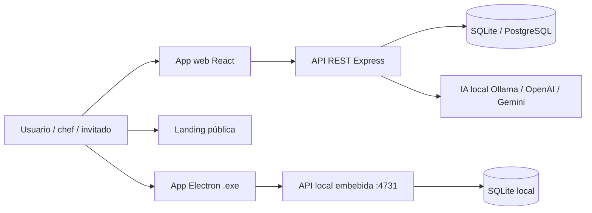
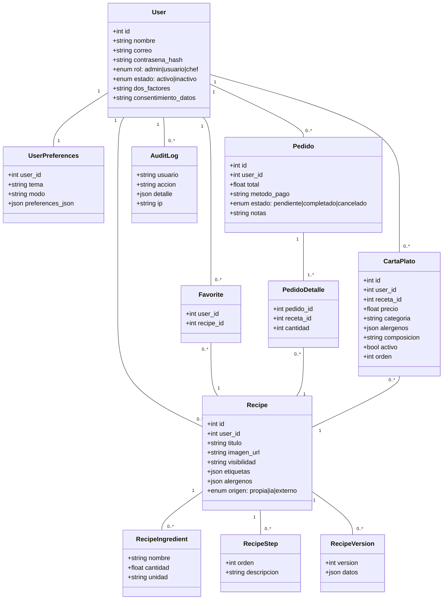
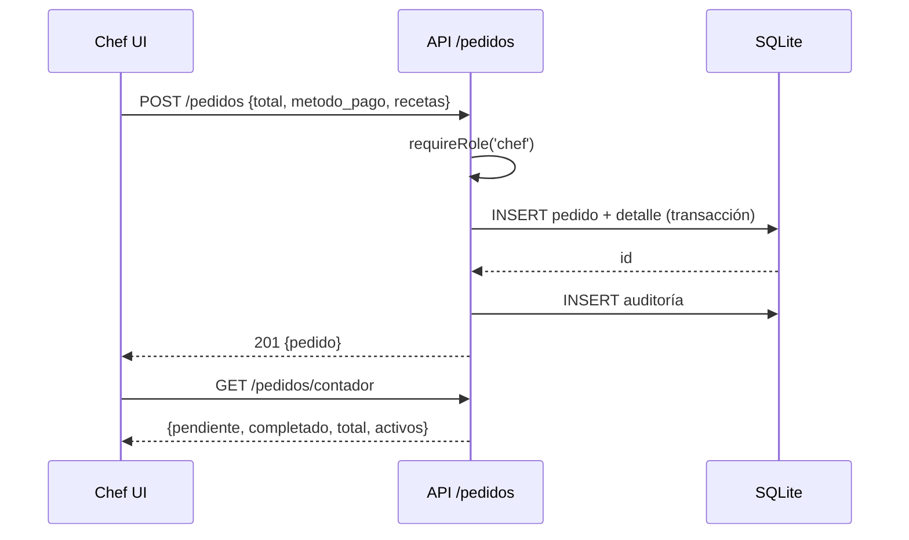
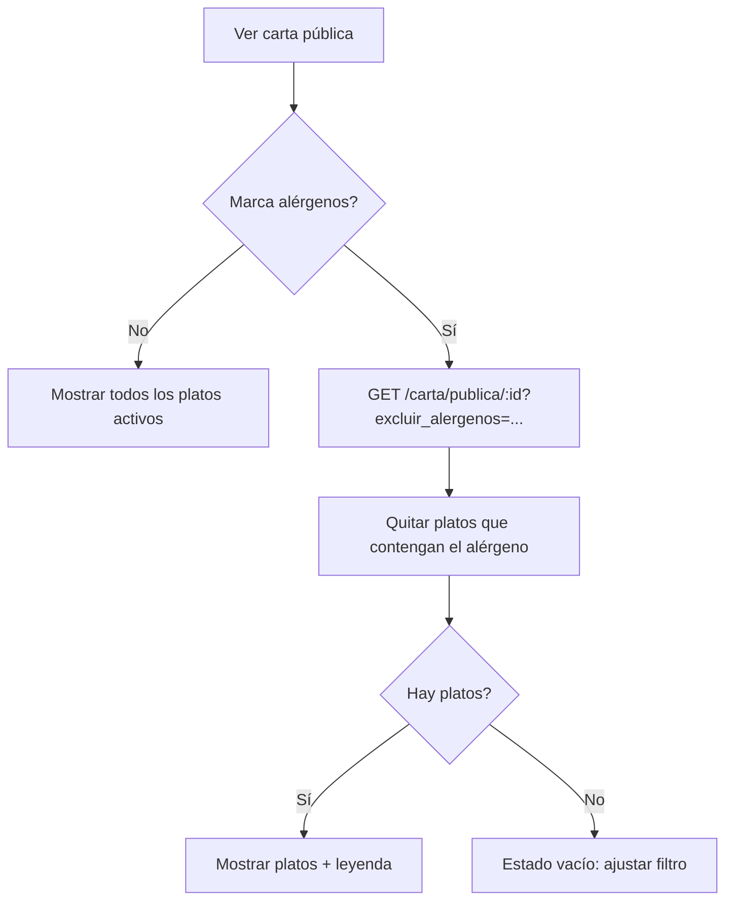
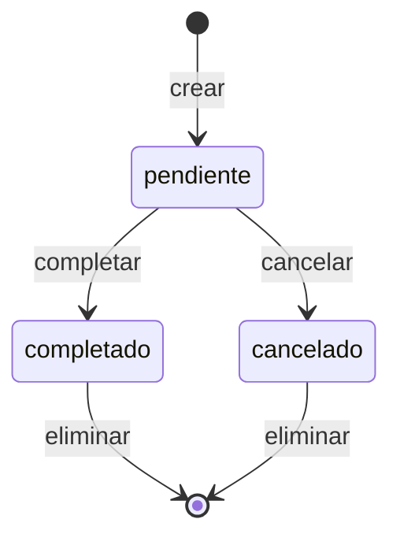

# Especificación de Requisitos de Software (IEEE 830-1998) — Recetario Inteligente «SazónLab»

**Versión:** 2.0 (reestructuración completa, 25/11/2026)
**Proyecto:** SazónLab — Recetario Inteligente
**Autores:** Alejandro Rua Toro (3410390) · José Germán Estrada Clavijo
**Estado:** Aprobado para construcción · Validado con QA por fase

---

## Ficha de control de cambios

| Fecha | Revisión | Cambio principal |
| --- | --- | --- |
| 23/07/2026 | 1.0 | Elicitación y primer SRS (RF-01…RF-13) |
| 30/07/2026 | 1.1 | Temas, accesibilidad y persistencia |
| 06/08/2026 | 1.2 | Seguridad, 2FA y consentimiento |
| 13/08/2026 | 1.3 | Exportación, compartir y notificaciones |
| 20/08/2026 | 1.4 | Multiplataforma y app de escritorio |
| 27/08/2026 | 1.5 | Panel de administración y auditoría |
| 18/11/2026 | 1.6 | Rol Chef/Restaurante (adicional, sin alterar los roles previos) |
| 25/11/2026 | **2.0** | Reestructuración IEEE 830-1998 completa: RS/RF/RNF, CU, modelo de dominio, diagramas, trazabilidad y 9 puntos del nuevo encargo |

---

# 1. Introducción

## 1.1 Propósito

Este documento especifica los requisitos de software de **SazónLab**, una aplicación web y de escritorio para buscar, crear, organizar y compartir recetas, y —a partir de esta revisión— para que un **Chef/Restaurante** administre su carta digital, precios, alérgenos, pedidos y código QR.

La especificación es la referencia contractual entre el cliente y el desarrollador y la base para el diseño, la implementación, las pruebas y la aceptación.

## 1.2 Alcance

- Aplicación web progresiva (Vite + React), landing pública y aplicación de escritorio Electron (`.exe`) con API local embebida.
- API REST (Node + Express + SQLite, con opción PostgreSQL) con autenticación JWT, roles y auditoría.
- Funciones: recetas propias/importadas/sugeridas por IA, búsqueda por ingredientes, favoritos, temas y accesibilidad, pedidos (chef), carta digital con alérgenos y precios, exportaciones PDF/imagen, QR, chat conversacional y medidas.
- Fuera de alcance: pago en línea, domicilios, inventario de cocina en tiempo real y autenticación con proveedores externos (OAuth).

## 1.3 Definiciones, acrónimos y abreviaturas

| Término | Definición |
| --- | --- |
| **RS** | Requisito del sistema (capacidad general exigida al producto). |
| **RF** | Requisito funcional (comportamiento observable y verificable). |
| **RNF** | Requisito no funcional (atributo de calidad o restricción). |
| **CU** | Caso de uso (interacción actor-sistema con resultado observable). |
| **Chef** |Usuario con rol `chef` (Chef/Restaurante). No sustituye ni modifica admin/usuario/invitado. |
| **Carta digital** | Vista pública de los platos del chef, accesible por URL/QR. |
| **Alérgeno** | Sustancia listada en `ALERGENOS` que puede excluir platos del comensal. |
| **Liquid Glass** | Estética de vidrio translúcido (blur + saturación) desactivable. |
| **SRS** | Software Requirements Specification (esta documento). |

## 1.4 Referencias normativas

1. **IEEE Std 830-1998**, *IEEE Recommended Practice for Software Requirements Specifications* — estructura y calidad del SRS.
2. **IEEE Std 1016-2009**, *Information Technology — Systems Design — Software Design Descriptions* — apoyo a los diagramas de diseño.
3. **IEEE Std 1471-2000**, *Recommended Practice for Architectural Description* — vistas y actores.
4. **WCAG 2.1** (W3C, nivel AA) — criterios de accesibilidad web adoptados por RNF-07.
5. **Ley 1581 de 2012** (Colombia) — tratamiento de datos personales y consentimiento (RF-26).

---

# 2. Descripción general

## 2.1 Perspectiva del producto

SazónLab es un sistema independiente. Se entrega en tres superficies que comparten la misma API:



## 2.2 Funcionalidades del producto (resumen)

| Área | Capacidades |
| --- | --- |
| Recetas | Crear, editar (con versiones), eliminar (papelera), Importar/Exportar JSON, compartir por enlace. |
| Búsqueda | Por ingredientes, nombre, categorías y filtros avanzados; sugerencias de IA/API externa. |
| Personalización | 12 temas × modos, accesibilidad, Liquid Glass conmutable, botón flotante de chat. |
| Chef | Panel propio, carta con precios, pedidos, alérgenos, QR y exportaciones. |
| Comensal | Carta digital pública con filtro de alérgenos y versión sin precios. |
| Plataformas | Web, landing y `.exe` con base local sin conexión. |

## 2.3 Clases de usuarios y permisos

| Rol | Permisos clave | Restricción |
| --- | --- | --- |
| **Invitado** | Buscar, ver recetas públicas, medidas, chat, ajustes locales. | No crea ni administra datos. |
| **Usuario registrado** | Lo anterior + recetas propias, favoritos, papelera, perfil, 2FA. | No ve pedidos ni panel chef. |
| **Administrador** | Lo anterior + panel de usuarios (crear/cambiar rol/inactivar/restablecer clave), auditoría. | **No ve Pedidos ni Panel del chef** (según revisión 2.0). |
| **Chef/Restaurante** | Lo anterior + panel propio, pedidos propios, carta, alérgenos, QR, exportaciones. | Gestiona **sus** recetas/platos/pedidos. |

> El rol Chef se **agregó** al sistema; los flujos de admin/usuario/invitado no se modificaron (RF-34).

## 2.4 Restricciones

- Stack existente se mantiene: React/Vite, Express, SQLite, Electron.
- Solo una dependencia nueva en el frontend: `qrcode` (offline).
- Sin menús ocultos: todas las acciones principales están a la vista.
- Datos sensibles: consentimiento Ley 1581, contraseñas con bcrypt, JWT con vencimiento de 7 días.
- El `.exe` y la demo web deben permanecer sincronizados con el código.

---

# 3. Requisitos específicos

## 3.1 Requisitos del sistema (RS)

| ID | Requisito del sistema | Descripción |
| --- | --- | --- |
| RS-01 | Gestión de recetas propias | Crear, consultar, actualizar, eliminar y recuperar recetas con ingredientes, pasos y metadatos. |
| RS-02 | Búsqueda inteligente | Ingresar ingredientes y devolver recetas ordenadas por faltantes; filtros avanzados e historial. |
| RS-03 | Sugerencia IA | Conectarse a APIs externas/IA para sugerir recetas. |
| RS-04 | Favoritos | Guardar, consultar y eliminar recetas favoritas. |
| RS-05 | Temas y modos | Doce temas con vista previa, persistencia y alto contraste independiente. |
| RS-06 | Accesibilidad | WCAG 2.1 AA, teclado, lector de pantalla, fuente, daltonismo y movimiento reducido. |
| RS-07 | Estructura semántica | Landmarks `<header>`, `<aside>`, `<main>`, `<footer>` y jerarquía de encabezados. |
| RS-08 | Notificaciones y modales | Toasts, modales glass y confirmaciones SweetAlert2. |
| RS-09 | Autenticación y seguridad | JWT, bcrypt, roles, 2FA, consentimiento y restablecimiento asistido. |
| RS-10 | Auditoría | Registro de operaciones críticas con usuario, fecha y IP. |
| RS-11 | Portabilidad | Exportar/importar recetas en JSON. |
| RS-12 | Multiplataforma | Web, landing y `.exe` Electron con SQLite embebida. |
| **RS-13** | **Pedidos del chef** | Lista CRUD de pedidos con filtros y contador de activos; acceso exclusivo del rol chef. |
| **RS-14** | **Descarga de recetas** | Menú desplegable con PDF e imagen para receta propia, importada o de IA. |
| **RS-15** | **Carta del chef** | Alta de platos desde recetas propias con precio, categoría, alérgenos y composición. |
| **RS-16** | **Alérgenos** | Precarga desde ingredientes, iconos, leyenda en exportes y filtro del comensal. |
| **RS-17** | **Personalización de carta** | Colores, orientación, tamaño, tipografía, versión, organización, logo y vista previa en vivo. |
| **RS-18** | **QR de la carta** | Generación personalizable en PNG/SVG/PDF que abre la carta digital. |
| **RS-19** | **Apariencia avanzada** | Rediseño visual, estados vacíos/carga/error y Liquid Glass desactivable y persistente. |

## 3.2 Requisitos funcionales (RF)

| ID | Nombre | Descripción verificable | Prioridad | CU |
| --- | --- | --- | --- | --- |
| RF-01 | Autenticación | Acceso con correo y contraseña cifrada validada en BD; 401 si falla. | ALTA | CU-01 |
| RF-02 | Roles y permisos | Admin, usuario, invitado y **chef**; el chef se agrega sin cambiar los otros. | ALTA | CU-02, CU-22 |
| RF-03 | Búsqueda por ingredientes | Chips de ingredientes → recetas ordenadas por faltantes. | ALTA | CU-03 |
| RF-04 | Sugerencia inteligente | Sugerencias de TheMealDB/IA a partir de ingredientes. | ALTA | CU-04 |
| RF-05 | Detalle de receta | Ingredientes, pasos, tiempo, dificultad, porciones, imagen y alérgenos. | ALTA | CU-05 |
| RF-06 | Crear receta | Formulario con validación (título ≥ 3) y alta en BD. | ALTA | CU-06 |
| RF-07 | Editar receta | Edición con snapshot de versión y restauración. | ALTA | CU-07, CU-16 |
| RF-08 | Eliminar receta | Borrado lógico con confirmación y papelera de 30 días. | ALTA | CU-09, CU-10 |
| RF-09 | Favoritos | Marcar/desmarcar y listar favoritos. | ALTA | CU-12 |
| RF-10 | Filtros avanzados | Tiempo, dificultad, dieta, tipo e ingredientes excluidos. | MEDIA | CU-33…36 |
| RF-11 | Historial de búsquedas | Guardar, repetir y vaciar búsquedas. | MEDIA | CU-15 |
| RF-12 | Compartir | Enlace público y copia de texto. | MEDIA | CU-17, CU-18 |
| RF-13 | Temas | 12 temas × modos con vista previa y persistencia. | ALTA | CU-13 |
| RF-14 | Ajustes de accesibilidad | Fuente, movimiento, alto contraste y daltonismo. | ALTA | CU-14 |
| RF-15 | Notificaciones | Toasts de éxito/error con historial. | ALTA | CU-19 |
| RF-16 | Modales | Diálogos glass con trampa de foco y Escape. | ALTA | CU-20 |
| RF-17 | Alertas | Confirmaciones destructivas con SweetAlert2. | ALTA | CU-20 |
| RF-18 | Iconografía | Font Awesome consistente con el diseño. | ALTA | CU-05 |
| RF-19 | Semántica | Landmarks ARIA y encabezados jerárquicos. | ALTA | CU-05 |
| RF-20 | Offline `.exe` | Consultar recetas locales sin Internet. | MEDIA | CU-56 |
| RF-21 | JSON | Exportar e importar recetas en JSON. | MEDIA | CU-21 |
| RF-22 | Gestión de usuarios | Admin crea, edita, inactiva y **asigna rol chef**; restablece claves. | ALTA | CU-22 |
| RF-23 | Auditoría | Log de operaciones críticas. | ALTA | CU-23 |
| RF-24 | Buscador global | Búsqueda transversal desde la cabecera. | MEDIA | CU-11 |
| RF-25 | Onboarding | Tour guiado omitible. | BAJA | CU-25 |
| RF-26 | Ley 1581 | Consentimiento de datos y cookies validado en cliente y servidor. | ALTA | CU-02 |
| RF-27 | 2FA | Código de 6 dígitos por correo, caducidad 5 min, 5 intentos. | ALTA | CU-01 |
| RF-28 | Restablecer clave | Admin restablece la clave de cualquier cuenta. | MEDIA | CU-22 |
| RF-29 | Daltonismo | Recolorización de estados sin depender del color. | MEDIA | CU-29 |
| RF-30 | Acceso flotante al asistente | FAB siempre visible que abre un **chat flotante propio** (no redirige). | MEDIA | CU-30 |
| RF-31 | Correo de soporte | Remitente único con aviso de confidencialidad. | MEDIA | CU-31 |
| **RF-32** | **Lista de pedidos** | Chef crea, edita, completa y elimina pedidos; filtros por estado y fechas; contador de activos en tarjetas y badge. Ni admin ni usuario acceden. | ALTA | CU-40…44 |
| **RF-33** | **Descarga de cualquier receta** | Menú desplegable «Descargar» con PDF (impresión) e imagen PNG, disponible en recetas propias, importadas y de IA. | ALTA | CU-45 |
| **RF-34** | **Rol Chef/Restaurante** | Solo el admin asigna el rol; el chef tiene panel propio con sus recetas, carta, pedidos, descargas y QR. Los demás roles no ven esas opciones. | ALTA | CU-22, CU-46 |
| **RF-35** | **Alérgenos por plato** | Iconos y leyenda, precarga editable desde ingredientes, composición visible y filtro del comensal que oculta platos con el alérgeno marcado. | ALTA | CU-47, CU-48 |
| **RF-36** | **Personalización de carta** | Modal con colores, orientación, A4/A5/carta/personalizado, tipografía, versión con/sin precio/ambas, organización, logo + nombre, alérgenos/composición, vista previa en vivo y export PDF/imagen. | ALTA | CU-49 |
| **RF-37** | **QR personalizable** | Color de primer plano/fondo, logo central, tamaño, marco y etiqueta; PNG/SVG/PDF; el QR abre la carta digital con las mismas opciones. | ALTA | CU-50 |
| **RF-38** | **Rediseño visual** | Design system, microinteracciones, estados vacíos/carga/error, contraste AA, controles táctiles ≥ 40 px y responsive. | ALTA | CU-51 |
| **RF-39** | **Liquid Glass configurable** | Interruptor en Ajustes > Apariencia, activo por defecto, persistente y con superficies sólidas legibles al desactivarse. | MEDIA | CU-52 |
| **RF-40** | **Medidas en menú lateral** | Enlace a «Medidas y equivalencias» visible en el sidebar para todos los roles, incluido invitado. | MEDIA | CU-53 |

**Total: 40 requisitos funcionales** (31 originales + 9 del encargo).

## 3.3 Requisitos no funcionales (RNF)

| ID | Nombre | Criterio medible | Prioridad |
| --- | --- | --- | --- |
| RNF-01 | Seguridad | bcrypt (≥10 rondas), JWT firmado, 403 por rol, auditoría de operaciones críticas. | ALTA |
| RNF-02 | Rendimiento | Búsqueda < 3 s; soporte ≥ 100 usuarios concurrentes. | ALTA |
| RNF-03 | Confiabilidad | Disponibilidad ≥ 99 %, respaldo diario, recuperación ≤ 4 h. | ALTA |
| RNF-04 | Mantenibilidad | Código modular y comentado; cambio menor ≤ 8 h sin regresiones. | MEDIA |
| RNF-05 | Usabilidad | Usuario nuevo completa tareas básicas < 15 min; controles táctiles ≥ 40 px. | ALTA |
| RNF-06 | Compatibilidad | Windows 10+, navegadores modernos, móvil responsive, JSON. | MEDIA |
| RNF-07 | Accesibilidad | WCAG 2.1 AA: axe sin violaciones serious/critical, 36 combinaciones de contraste. | ALTA |
| RNF-08 | Escalabilidad | Hasta 500 usuarios concurrentes sin rediseño. | MEDIA |
| RNF-09 | Trazabilidad | Todo RF tiene CU, RS, RNF, módulo y evidencia de QA. | MEDIA |
| RNF-10 | Integridad | Transacciones ACID y validaciones DB (CHECK, UNIQUE, FK). | ALTA |
| **RNF-11** | **Exportación sin dependencias** | PDF por diálogo de impresión e imagen por canvas; única librería nueva: `qrcode`. | MEDIA |
| **RNF-12** | **Migración segura** | Bases antiguas conservan usuarios, preferencias y recetas al añadir chef/alérgenos. | ALTA |

---

# 4. Modelo de dominio



**Reglas de integridad:** `carta_platos (user_id, receta_id)` UNIQUE; `pedidos` CASCADE a detalle; `recipes.alergenos` y `carta_platos.alergenos` en JSON validado; CHECK de rol ampliado con migración segura (RNF-12).

---

# 5. Casos de uso

## 5.1 Diagrama de casos de uso

```mermaid
useCaseDiagram
  actor Invitado
  actor Usuario
  actor Admin
  actor Chef
  actor Comensal

  Invitado --> UC01_IniciarSesion
  Invitado --> UC03_Buscar
  Invitado --> UC53_Medidas
  Usuario --> UC05_VerReceta
  Usuario --> UC06_CrearReceta
  Usuario --> UC07_EditarReceta
  Usuario --> UC12_Favoritos
  Usuario --> UC45_Descargar
  Admin --> UC22_GestionarUsuarios
  Admin --> UC23_Auditoria
  Chef --> UC40_Pedidos
  Chef --> UC46_PanelChef
  Chef --> UC49_PersonalizarCarta
  Chef --> UC50_GenerarQR
  Chef --> UC45_Descargar
  Comensal --> UC48_CartaPublica
  Comensal --> UC47_FiltrarAlergenos
```

## 5.2 Catálogo de casos de uso

| CU | Nombre | Actor | RF |
| --- | --- | --- | --- |
| CU-01 | Iniciar sesión (con 2FA opcional) | Invitado | RF-01, RF-27 |
| CU-02 | Registrarse con consentimiento | Invitado | RF-26 |
| CU-03 | Buscar por ingredientes | Todos | RF-03 |
| CU-04 | Solicitar sugerencia IA | Usuario | RF-04 |
| CU-05 | Ver detalle de receta | Todos | RF-05 |
| CU-06 / 07 | Crear / editar receta | Usuario | RF-06, RF-07 |
| CU-09 / 10 | Eliminar / restaurar receta | Usuario | RF-08 |
| CU-12 | Gestionar favoritos | Usuario | RF-09 |
| CU-13 | Elegir tema y modo | Todos | RF-13 |
| CU-14 | Ajustar accesibilidad | Todos | RF-14 |
| CU-17 / 18 | Compartir enlace / texto | Usuario | RF-12 |
| CU-19 / 20 | Notificaciones / modales | Todos | RF-15…17 |
| CU-21 | Exportar/importar JSON | Usuario | RF-21 |
| CU-22 | Gestionar usuarios y roles (incluye chef) | Admin | RF-02, RF-22, RF-28, RF-34 |
| CU-23 | Consultar auditoría | Admin | RF-23 |
| CU-30 | Usar chat flotante | Todos | RF-30 |
| CU-40 | Crear y listar pedidos | Chef | RF-32 |
| CU-41 | Filtrar pedidos por estado/fechas | Chef | RF-32 |
| CU-42 | Editar pedido | Chef | RF-32 |
| CU-43 | Completar pedido | Chef | RF-32 |
| CU-44 | Eliminar pedido | Chef | RF-32 |
| CU-45 | Descargar receta (PDF/imagen) | Usuario/Chef | RF-33 |
| CU-46 | Gestionar panel propio | Chef | RF-34 |
| CU-47 | Ver alérgenos y composición | Todos | RF-35 |
| CU-48 | Filtrar carta por alérgeno | Comensal | RF-35 |
| CU-49 | Personalizar carta y exportar | Chef | RF-36 |
| CU-50 | Generar y descargar QR | Chef | RF-37 |
| CU-51 | Navegar con diseño responsive/AA | Todos | RF-38 |
| CU-52 | Activar/desactivar Liquid Glass | Todos | RF-39 |
| CU-53 | Consultar medidas y equivalencias | Todos | RF-40 |

## 5.3 Especificaciones detalladas (selección)

### CU-40 — Crear pedido

| Campo | Valor |
| --- | --- |
| Actor principal | Chef autenticado |
| Precondición | Sesión con rol `chef`; existen recetas propias |
| Flujo principal | 1) Pulsa «Nuevo pedido» → 2) elige recetas y cantidades → 3) indica total y método de pago → 4) guarda |
| Flujo alterno | Sin recetas seleccionadas → error «Selecciona al menos una receta» |
| Postcondición | Pedido `pendiente` con detalle en `pedido_detalle`; contador y badge +1 |
| Excepciones | 403 si el rol no es chef; 400 si total inválido |

### CU-48 — Ocultar platos por alérgeno

| Campo | Valor |
| --- | --- |
| Actor principal | Comensal (sin sesión) |
| Precondición | Carta pública con platos |
| Flujo principal | 1) Marca «Gluten» → 2) la API filtra `excluir_alergenos=gluten` → 3) desaparecen los platos que lo contienen |
| Flujo alterno | «Quitar filtro» restaura la carta |
| Postcondición | Lista visible sin platos con el alérgeno marcado |

### CU-49 — Personalizar y exportar carta

| Campo | Valor |
| --- | --- |
| Actor principal | Chef |
| Flujo principal | 1) Abre modal → 2) ajusta colores/tamaño/tipografía/versión → 3) ve vista previa en vivo → 4) guarda → 5) exporta PDF o PNG |
| Postcondición | `user_preferences.preferences_json` actualizado; export con leyenda de alérgenos |

---

# 6. Diagramas de comportamiento

## 6.1 Secuencia: alta de pedido



## 6.2 Actividad: filtro del comensal



## 6.3 Estados del pedido



---

# 7. Trazabilidad

Matriz RF → RS → RNF → CU → módulo → QA.

| RF | RS | RNF | CU | Módulo / archivo | Evidencia QA |
| --- | --- | --- | --- | --- | --- |
| RF-01…02 | RS-09 | RNF-01 | CU-01/02 | `auth.js`, `authStore.js` | `verificar:auth` |
| RF-03…04 | RS-02/03 | RNF-02 | CU-03/04 | `Buscar.jsx`, `chat.js` | `verificar:busqueda` |
| RF-05…08 | RS-01 | RNF-05 | CU-05…10 | `RecetaDetalle.jsx`, `RecetaForm.jsx`, `recipes.js` | `verificar:recetas` |
| RF-13…14 | RS-05/06 | RNF-07 | CU-13/14 | `themeStore.js`, `themes/` | `verificar:temas`, `verificar:contraste` |
| RF-22…23 | RS-09/10 | RNF-01 | CU-22/23 | `admin.js`, `Admin.jsx` | `verificar:auth`, `verificar:cuenta` |
| RF-30 | RS-08 | RNF-05 | CU-30 | `ChatFab.jsx`, `Chat.jsx` | `verificar:movil`, `verificar:carta` |
| **RF-32** | RS-13 | RNF-01/10 | CU-40…44 | `pedidos.js`, `Pedidos.jsx`, `pedidosStore.js` | `qa-encargo` (26/26), `verificar:pedidos` |
| **RF-33** | RS-14 | RNF-11 | CU-45 | `exportarReceta.js`, `MenuDescargas.jsx` | `verificar:carta` |
| **RF-34** | RS-15 | RNF-12 | CU-46 | `admin.js`, `ChefPanel.jsx`, `AppSidebar.jsx` | `verificar:pedidos`, `verificar:carta` |
| **RF-35** | RS-16 | RNF-10 | CU-47/48 | `alergenos.js`, `carta.js`, `CartaPublica.jsx` | `verificar:carta` |
| **RF-36** | RS-17 | RNF-11 | CU-49 | `PersonalizarCarta.jsx`, `exportarCarta.js` | `verificar:carta` |
| **RF-37** | RS-18 | RNF-11 | CU-50 | `qr.js`, `GenerarQR.jsx` | `verificar:carta` |
| **RF-38** | RS-19 | RNF-05/07 | CU-51 | `index.css`, componentes | `verificar:movil`, `verificar:a11y` |
| **RF-39** | RS-19 | RNF-05/12 | CU-52 | `themeStore.js`, `Ajustes.jsx` | `verificar:glass` |
| **RF-40** | RS-19 | RNF-05 | CU-53 | `AppSidebar.jsx` | `verificar:carta`, `verificar:movil` |

---

# 8. Criterios de aceptación y validación

## 8.1 Checklist por funcionalidad

| Funcionalidad | Criterio de aceptación | Estado |
| --- | --- | --- |
| Pedidos (RF-32) | CRUD + filtros + contador; menú solo chef; admin recibe 403 en API | ✅ |
| Descargas (RF-33) | Menú «Descargar» con PDF/imagen en cualquier receta | ✅ |
| Chef (RF-34) | Admin asigna rol; panel propio; admin/usuario sin acceso | ✅ |
| Alérgenos (RF-35) | Precarga, iconos, leyenda, composición y filtro comensal | ✅ |
| Carta (RF-36) | Modal, vista previa, todas las opciones y export PDF/PNG | ✅ |
| QR (RF-37) | PNG/SVG/PDF, colores, logo, marco y etiqueta; abre carta | ✅ |
| Rediseño (RF-38) | AA, táctil ≥40 px, responsive, estados vacíos/carga/error | ✅ |
| Liquid Glass (RF-39) | Default on, persistente, sin blur al apagarlo | ✅ |
| Medidas (RF-40) | Enlace en sidebar para todos los roles | ✅ |
| Regresión | 14 suites QA + 23 tests unitarios + lint sin errores | ✅ |

## 8.2 Comandos de verificación

```bash
npm run lint
npm test
npm run verificar:pedidos
npm run verificar:carta
npm run verificar:glass
npm run verificar:desktop
```

---

# Apéndice A — Cambios respecto a la versión 1.6

1. Reestructuración completa según IEEE 830-1998 (secciones 1-8 + apéndices).
2. Separación explícita de RS/RF/RNF, con IDs estables y nuevos RF-32…RF-40.
3. Modelo de dominio y diagramas Mermaid (casos de uso, secuencia, actividad, estados, componentes).
4. Matriz de trazabilidad requisito → caso de uso → módulo → evidencia.
5. **Pedidos y Panel del chef son exclusivos del rol chef; el administrador ya no los ve** (decisión del cliente).
6. Chat flotante separado del Asistente; Medidas añadido al menú lateral de todos los usuarios.
7. Liquid Glass documentado como configurable y persistente.

# Apéndice B — Glosario

- **API embebida:** servidor Express dentro del `.exe` en `127.0.0.1:4731`.
- **Hash:** resultado de bcrypt storing de la contraseña (nunca se guarda en texto plano).
- **Alérgeno precargado:** sugerencia automática por coincidencia de nombres de ingredientes, editable por el chef.
- **Vista previa en vivo:** representación de la carta que se actualiza al cambiar cada opción del modal.

---

*Documento conforme a IEEE Std 830-1998. Última actualización: 25/11/2026.*
